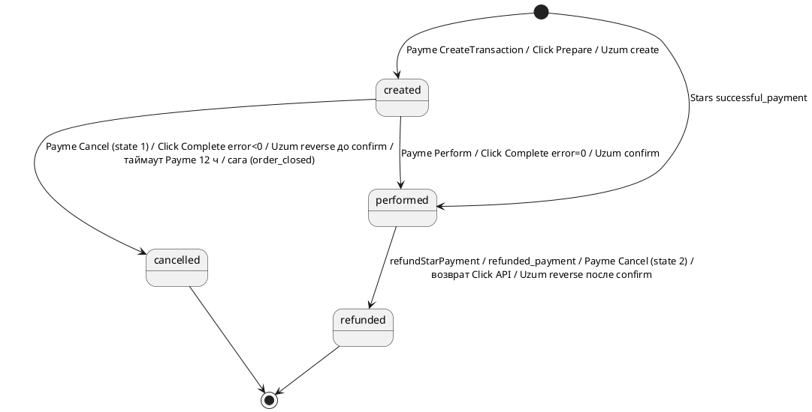
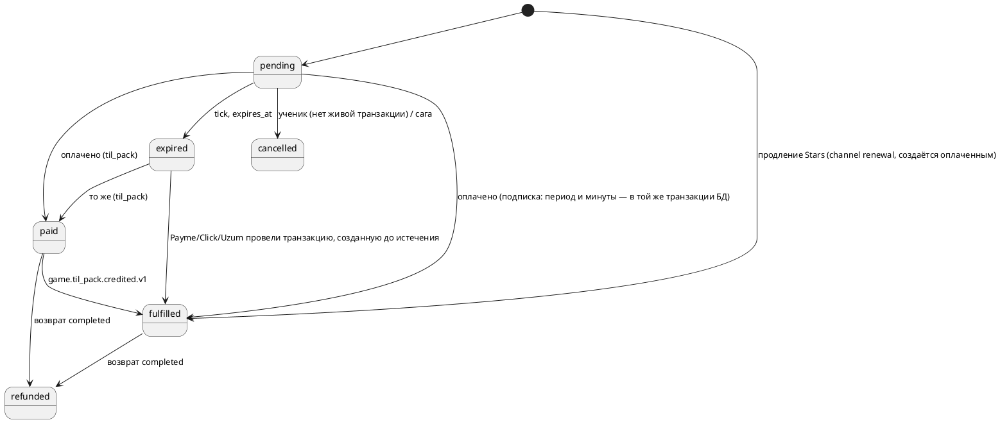
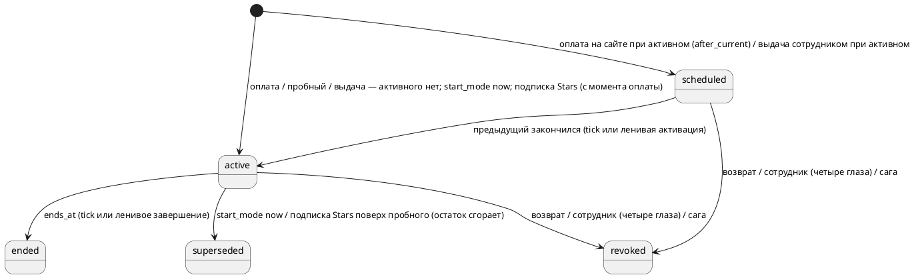

# Спринт 8 — внутренние контракты (деньги и контроль ИИ)

Публичные API:
- ученик в Mini App — `packages/contracts/src/bff.ts`, раздел «Спринт 8»;
- сайт оплаты — `packages/contracts/src/web.ts` (новый, только маршруты `/web/v1/*`);
- админка — `admin.ts`, раздел «Деньги» и дополнения «ИИ, затраты»;
- ИИ — `ai.ts` (`AiStatus`, `AiBudget`, деградация, стоимость занятий);
- события — `packages/contracts/events/*.schema.json` (генерируются `infra/scripts/gen_event_schemas.py`).

Формы ответов ниже — кратко (суть и поля домена); полная форма, коды ошибок и правила — в типах и комментариях
контрактов, при расхождении источник истины — они. Решения владельца и координатора, открытые вопросы — [PLAN.md](PLAN.md),
исполнители — [AGENT_BRIEF.md](AGENT_BRIEF.md), что не подтверждено документацией — §14, источники — §15.

Общие механизмы — как в спринтах 1–7: внутренний JWT (`sub`, `lrn`, `age_band`; новый claim `chn`), actor, права в
домене, outbox/inbox с проверкой издателя, ErrorBody, Idempotency-Key, пагинация, сага удаления, аудит, step-up
заголовком `X-Step-Up: ok` от admin-bff, tick по `SCHEDULER_TOKEN`.

## 0. Общее

### 0.1 Где что живёт
- **billing (новый, 8118, схема `billing`)** — каталог тарифов и товаров с версиями (цены в сумах и в Stars), заказы
  по каналам, платёжный контур и адаптеры, фискальные данные, периоды и подписки Stars, реестр минут и удержания,
  возвраты, корректировки «четыре глаза», сверка, отчёты и курсы, проекция учеников.
- **telegram-bot-gateway** — единственный, кто вызывает Bot API для Stars (токен бота у него) и принимает платёжные
  обновления Telegram (§2).
- **web-pay (новый, публичный)** — сайт оплаты вне Telegram: статика за Caddy; API — telegram-bff `/web/v1/*` (§3).
- **payments-edge (новый, публичный, Caddy)** — только колбэки Payme, Click, Uzum (§4).
- **lessons** — режим занятия по тарифу, удержание и подсчёт ИИ-минут. **gamification** — тилы по заказу.
- **ai-gateway** — контроль ИИ. **notifications** — сообщения об оплате и подписке. **identity-consent** — связь
  Telegram ID ↔ аккаунт для bot-gateway и сайта.

### 0.2 Каналы продаж и анти-стиринг (решение владельца В1)
| Канал (`chn`) | Откуда | Провайдеры | Цены | Кто выпускает токен |
|---|---|---|---|---|
| `miniapp` | Mini App (initData) | только `telegram_stars` | только Stars (`price_stars`) | telegram-bff `/v1/*` |
| `web` | сайт оплаты (вход через Telegram, OIDC) | только `payme`, `click`, `uzum` | только сумы (`price_tiyin`) | telegram-bff `/web/v1/*` |
| `renewal` | автопродление подписки Stars | `telegram_stars` | цена первого платежа | billing сам (по `successful_payment`) |

- billing проверяет пару «канал — провайдер» и фильтрует каталог по каналу; несовпадение — 422 `PROVIDER_NOT_ALLOWED`.
- **Анти-стиринг:** ни один ответ канала `miniapp`, текст бота (включая `/paysupport`, `/terms`), шаблон уведомления
  или заметка «Что нового» не содержит адреса сайта, ссылки или кнопки на него, цен в сумах, названий Payme, Click,
  Uzum и формулировок «дешевле / другим способом». API канала `miniapp` не отдаёт заказы канала `web`: покупка на сайте
  видна в Mini App только как статус подписки и минуты. Уведомления о заказах `web` — нейтральные (§8).
- Направление «сайт → Telegram» разрешено (например, «Аккаунт не найден — откройте TilHero в Telegram»).

### 0.3 Синхронные вызовы (новые)
| Кто → кого | Зачем | Таймаут, отказ |
|---|---|---|
| telegram-bff → billing | API ученика (`chn miniapp`) и сайта (`chn web`) `/internal/v1/me/billing/*` | 5 с; 503 `BILLING_UNAVAILABLE` |
| lessons → billing | `POST /internal/v1/holds`, `GET /internal/v1/access/{user_id}` | 2 с; нет ответа — занятие без ИИ |
| billing → telegram-bot-gateway | `/internal/v1/stars/*`: ссылка на счёт, возврат, автопродление, выписка | 5 с; 503 `STARS_UNAVAILABLE` |
| telegram-bot-gateway → billing | `/internal/v1/stars/*`: pre-checkout, платёж, возврат, состояние подписки | 3 с (pre-checkout), 5 с (прочее) |
| telegram-bot-gateway, telegram-bff → identity-consent | Telegram ID → аккаунт; аккаунт → Telegram ID (только bot-gateway) | 2 с |
| billing → gamification | `GET /internal/v1/game/purchases/by-order/{order_id}` (пред-проверка возврата тилов) | 5 с |
| billing → identity-consent | `GET /internal/v1/export/profiles` (начальная загрузка проекции) | в фоне, повтор tick'ом |
| telegram-bff → oauth.telegram.org | обмен `code` на `id_token`, JWKS | 5 с; вход не удался — понятная ошибка |
| admin-bff → billing | `/internal/v1/admin/billing/*` | как прочие домены |
| payments-edge → billing | `/provider/v1/*` | 10 с |
| billing → Click Merchant API, Payme Subscribe API (необяз.), Uzum (после сверки) | статус, отмена, фискализация | 10 с, один повтор на сеть/5xx |

Новые издатели и вызывающие внутреннего JWT: billing (к bot-gateway, gamification, identity-consent),
telegram-bot-gateway (к billing). Открытые ключи — у получателей **до** запуска (DEPLOYMENT §11 п. 8). Внутренний порт
bot-gateway принимает `iss` notifications (сообщения) и billing (`/stars/*`).

### 0.4 Деньги
- **Сумы — целые тийины** (`BIGINT`, 1 сум = 100 тийинов, валюта `UZS`); **Stars — целые звёзды** (`INTEGER`, валюта
  `XTR`). В заказе, транзакции и возврате заполнено ровно одно из `amount_tiyin` / `amount_stars` (CHECK). Пересчёта
  между ними в домене нет; float и `Decimal` для денег не используются (ADR-0001).
- Цена сайта — целые сумы (`price_tiyin % 100 = 0`); Click присылает `amount` строкой в сумах (`15000.00`) — разбор
  `^\d{1,12}(\.\d{1,2})?$` в тийины целочисленно, иная форма — `-2`.
- Курсы для отчётов: «тийинов за 1 USD» (`fx_rates`) и «тийинов за 1 Star» — оценка вознаграждения (`star_rates`);
  используются только в отчётах (admin-bff, целочисленно, half-up).
- Время провайдеров: Payme — мс (13 цифр); Click — `YYYY-MM-DD HH:mm:ss`; Uzum — мс (по сторонним реализациям);
  Telegram — Unix-секунды. Хранение — `timestamptz` UTC.

### 0.5 Плательщик, получатель, аудитории
- **Аккаунт** — `account_id` = `user_id` аккаунта Telegram. Детский профиль — ученик с `account_id` опекуна.
- **Подписка и минуты — на аккаунт**: пул общий у аккаунта и его детских профилей.
- **Плательщик** — владелец аккаунта в своём профиле (`lrn = sub`): 18+ или 14–17 с `guardian_consent = granted`.
  Детский профиль → 403 `PAYER_REQUIRED`; подросток без согласия → 403 `GUARDIAN_CONSENT_REQUIRED`; возраст неизвестен →
  `PAYER_REQUIRED`. Stars: платит Telegram-пользователь владельца аккаунта (проверка в `pre_checkout_query`, §1.5).
- **Получатель**: подписка — сам аккаунт; пакет тилов — аккаунт или его детский профиль (`beneficiary_id`), иначе 403
  `BENEFICIARY_NOT_ALLOWED`. На сайте входит только владелец аккаунта (у детей нет своего Telegram).

### 0.6 Что бесплатно и что платно
| Возможность | Без подписки | С подпиской | Минуты |
|---|---|---|---|
| Урок, сценарий (`kind lesson \| scenario`), 14+ | «варианты» (`ai_mode choices`, `ai_locked`) | `full` | `⌈ai_active_seconds/60⌉` |
| Медиа, повтор ошибок, чтение, дуэль, повторения, перевод по тапу, произношение | как сейчас | как сейчас | нет |
| Урок вдвоём 14+ (коуч) | приглашать нельзя; принять приглашение подписчика — можно | можно | у пригласившего, `⌈coach_active_seconds/60⌉` |
| Урок вдвоём с ребёнком (только сценарий) | можно | можно | нет |
| Игра, лиги, дуэли, магазин за тилы | да | да | — |
| Дети 6–13 | ИИ в уроках не включается (спринт 4) | — | — |

Источник подписки (Stars, сайт, пробный, выдача) на доступ не влияет.

### 0.7 Флаги запуска
| Сервис | Переменная | По умолчанию | Смысл |
|---|---|---|---|
| billing | `PAYMENTS_ENABLED` | false (stage/prod), true (dev/test) | общий выключатель новых заказов и приёма платежей |
| billing | `STARS_ENABLED` | false | продажи в Mini App; pre-checkout отклоняется, платёж по уже одобренному счёту — принимается |
| billing | `PAYME_ENABLED`, `CLICK_ENABLED`, `UZUM_ENABLED` | false | провайдер на сайте и колбэки; Uzum — после сверки спецификации |
| telegram-bff | `WEB_PAY_ENABLED` | false | маршруты `/web/v1/*` (вход и оплата на сайте); false — 404 |
| lessons | `BILLING_ENFORCED` | false | пэйвол уроков с ИИ и уроков вдвоём |
| billing | `TRIAL_ON_ENFORCEMENT` | false | разрешает разовую выдачу пробного всем активным 14+ (`POST …/trials:grant-all`) |

### 0.8 Секреты
- **Токен бота** — только у telegram-bot-gateway (Bot API) и telegram-bff (проверка initData), как сейчас. Никуда
  больше не передаётся: billing и сайт работают через внутренний API bot-gateway и OIDC.
- **Ключи провайдеров** — только переменные billing, вводит владелец (общие переменные проекта, ссылка
  `${{shared.<ИМЯ>}}` только у billing): `PAYME_KEY`, `PAYME_SUBSCRIBE_KEY` (необяз.), `CLICK_SECRET_KEY`,
  `UZUM_PASSWORD`. `PAYMENTS_EDGE_TOKEN` (billing и payments-edge) генерирует `setup.py`.
- **Секрет клиента «Log In with Telegram»** (`TELEGRAM_LOGIN_CLIENT_SECRET`, из BotFather) — только telegram-bff, вводит
  владелец. `WEB_SESSION_SECRET` — telegram-bff, генерирует `setup.py`.
- Не в БД, логах, событиях, ответах, `repr`, тексте ошибок. Админка показывает только «задан / не задан». Фильтр логов
  `tilhero_common.logging` дополняется ключами `authorization`, `sign_string`, `secret_key`, `password`, `key`,
  `client_secret`, `code`, `code_verifier`, `id_token` (запрос к общему коду — поток 0).
- Telegram ID не попадает в billing, события и логи billing: bot-gateway и telegram-bff переводят его в `account_id`.

## 1. billing (8118)

### 1.1 Схема данных (DDL)
Сервис работает под ролью `billing` (DML), миграции — `billing_owner`. Ниже — основные таблицы; плюс общие
`outbox`, `inbox`, `idempotency`, `deleted_users`, `tick_state`, `projection_loads`.

```sql
-- Проекция учеников (identity-consent)
CREATE TABLE learners (
  user_id            uuid PRIMARY KEY,
  account_id         uuid NOT NULL,
  kind               text NOT NULL CHECK (kind IN ('account','child')),
  age_band           text CHECK (age_band IN ('6-9','10-13','14-17','18+')),
  guardian_consent   text CHECK (guardian_consent IN ('not_required','pending','granted','declined')),
  profile_updated_at timestamptz,
  updated_at         timestamptz NOT NULL DEFAULT now(),
  CHECK ((kind = 'account') = (account_id = user_id))
);
CREATE INDEX ix_learners_account ON learners (account_id);

-- Каталог тарифов и товаров: версии (как правила игры спринта 6)
CREATE TABLE catalog_versions (
  version        integer PRIMARY KEY CHECK (version >= 1),
  status         text NOT NULL CHECK (status IN ('draft','active','archived')),
  payload        jsonb NOT NULL,
  payload_hash   text NOT NULL,                 -- sha256 канонического JSON
  validated_hash text,                          -- payload_hash успешной проверки; NULL — не проверен
  comment        text CHECK (char_length(comment) <= 500),
  created_by     text NOT NULL,
  created_at     timestamptz NOT NULL DEFAULT now(),
  updated_at     timestamptz NOT NULL DEFAULT now(),
  activated_by   text,
  activated_at   timestamptz
);
CREATE UNIQUE INDEX uq_catalog_draft  ON catalog_versions ((true)) WHERE status = 'draft';
CREATE UNIQUE INDEX uq_catalog_active ON catalog_versions ((true)) WHERE status = 'active';
-- триггер catalog_guard: active/archived неизменяемы; переходы draft→active, active→archived

-- Подписки Stars (нативная подписка Telegram, §1.5)
CREATE TABLE stars_subscriptions (
  subscription_id uuid PRIMARY KEY,
  account_id      uuid,                         -- NULL после саги
  product_code    text NOT NULL,
  first_order_id  uuid NOT NULL UNIQUE,
  first_charge_id text NOT NULL UNIQUE,         -- telegram_payment_charge_id первого платежа (editUserStarSubscription)
  last_charge_id  text NOT NULL,
  amount_stars    integer NOT NULL CHECK (amount_stars BETWEEN 1 AND 10000),
  status          text NOT NULL CHECK (status IN ('active','canceled','failed','refunded','ended')),
  expires_at      timestamptz NOT NULL,         -- subscription_expiration_date последнего платежа
  renewals        integer NOT NULL DEFAULT 0 CHECK (renewals >= 0),
  created_at      timestamptz NOT NULL DEFAULT now(),
  updated_at      timestamptz NOT NULL DEFAULT now()
);
CREATE UNIQUE INDEX uq_stars_sub_live ON stars_subscriptions (account_id) WHERE status IN ('active','canceled','failed');

-- Заказ: что, кому, за сколько, через кого, из какого канала
CREATE TABLE orders (
  order_id         uuid PRIMARY KEY,
  order_no         bigint GENERATED ALWAYS AS IDENTITY (START WITH 100001) UNIQUE,  -- account.order_id / merchant_trans_id
  account_id       uuid,                        -- плательщик; NULL после саги
  beneficiary_id   uuid,                        -- получатель; NULL после саги
  channel          text NOT NULL CHECK (channel IN ('miniapp','web','renewal')),
  product_code     text NOT NULL CHECK (product_code ~ '^[a-z0-9_]{2,40}$'),
  product_kind     text NOT NULL CHECK (product_kind IN ('subscription','til_pack')),
  catalog_version  integer NOT NULL REFERENCES catalog_versions(version),
  product_snapshot jsonb NOT NULL,              -- цена, дни, минуты, тилы, функции, названия RU/UZ, фискальные реквизиты
  provider         text NOT NULL CHECK (provider IN ('telegram_stars','payme','click','uzum')),
  currency         text NOT NULL CHECK (currency IN ('UZS','XTR')),
  amount_tiyin     bigint  CHECK (amount_tiyin BETWEEN 100 AND 100000000000),
  amount_stars     integer CHECK (amount_stars BETWEEN 1 AND 100000),
  stars_mode       text CHECK (stars_mode IN ('one_time','subscription')),
  stars_subscription_id uuid REFERENCES stars_subscriptions(subscription_id),       -- продление
  invoice_link     text CHECK (invoice_link IS NULL OR invoice_link ~ '^https://t\.me/'),
  start_mode       text CHECK (start_mode IN ('after_current','now')),
  status           text NOT NULL CHECK (status IN ('pending','paid','fulfilled','expired','cancelled','refunded')),
  offer_version    text NOT NULL CHECK (char_length(offer_version) BETWEEN 1 AND 20),
  locale           text NOT NULL CHECK (locale IN ('ru','uz')),
  idempotency_key  text NOT NULL,
  expires_at       timestamptz NOT NULL,
  created_at       timestamptz NOT NULL DEFAULT now(),
  paid_at          timestamptz,
  fulfilled_at     timestamptz,
  closed_at        timestamptz,                 -- expired | cancelled | refunded
  UNIQUE (account_id, idempotency_key),
  CHECK ((currency = 'XTR') = (provider = 'telegram_stars')),
  CHECK ((currency = 'UZS') = (amount_tiyin IS NOT NULL)),
  CHECK ((currency = 'XTR') = (amount_stars IS NOT NULL)),
  CHECK ((provider = 'telegram_stars') = (channel IN ('miniapp','renewal'))),
  CHECK ((currency = 'XTR') = (stars_mode IS NOT NULL)),
  CHECK ((channel = 'renewal') = (stars_subscription_id IS NOT NULL)),
  CHECK (start_mode IS NULL OR product_kind = 'subscription'),
  CHECK ((status IN ('paid','fulfilled','refunded')) = (paid_at IS NOT NULL))
);
CREATE INDEX ix_orders_account ON orders (account_id, created_at DESC);
CREATE INDEX ix_orders_pending ON orders (expires_at) WHERE status = 'pending';
ALTER TABLE stars_subscriptions ADD FOREIGN KEY (first_order_id) REFERENCES orders(order_id);

-- Транзакция провайдера (попытка оплаты; у Stars — подтверждённый платёж)
CREATE TABLE provider_transactions (
  txn_id          uuid PRIMARY KEY,
  seq             bigint GENERATED ALWAYS AS IDENTITY UNIQUE,  -- transaction (Payme), merchant_prepare_id/confirm_id (Click)
  provider        text NOT NULL CHECK (provider IN ('telegram_stars','payme','click','uzum')),
  provider_txn_id text NOT NULL CHECK (char_length(provider_txn_id) BETWEEN 1 AND 128),  -- Stars: telegram_payment_charge_id
  order_id        uuid NOT NULL REFERENCES orders(order_id),
  amount_tiyin    bigint  CHECK (amount_tiyin > 0),
  amount_stars    integer CHECK (amount_stars > 0),
  state           text NOT NULL CHECK (state IN ('created','performed','cancelled','refunded')),
  cancel_reason   text CHECK (cancel_reason IN ('receivers_not_found','debit_error','execution_error','timeout',
                                                'refund','unknown','provider_error','order_closed')),
  provider_reason smallint,                     -- Payme reason как пришёл (1, 2, 3, 4, 5, 10)
  provider_time   timestamptz,                  -- Payme params.time, Click sign_time, Uzum timestamp, Stars message.date
  provider_meta   jsonb NOT NULL DEFAULT '{}',  -- click_paydoc_id, payment_id Click, paymentSource Uzum, is_recurring Stars; без карт, секретов, Telegram ID
  created_at      timestamptz NOT NULL DEFAULT now(),
  performed_at    timestamptz,
  cancelled_at    timestamptz,                  -- для refunded — время возврата
  UNIQUE (provider, provider_txn_id),
  CHECK ((amount_tiyin IS NULL) <> (amount_stars IS NULL)),
  CHECK ((provider = 'telegram_stars') = (amount_stars IS NOT NULL)),
  CHECK ((state IN ('performed','refunded')) = (performed_at IS NOT NULL)),
  CHECK ((state IN ('cancelled','refunded')) = (cancelled_at IS NOT NULL))
);
CREATE UNIQUE INDEX uq_txn_order_performed ON provider_transactions (order_id) WHERE state = 'performed';
CREATE INDEX ix_txn_created ON provider_transactions (created_at) WHERE state = 'created';
-- триггер txn_guard: только переходы §1.4 (Stars создаётся сразу performed)

-- Ответы на pre_checkout_query (Stars), хранение 30 дней
CREATE TABLE stars_pre_checkouts (
  query_id    text PRIMARY KEY CHECK (char_length(query_id) <= 128),
  order_id    uuid,
  ok          boolean NOT NULL,
  error_code  text,
  answered_at timestamptz NOT NULL DEFAULT now()
);

-- Фискальные чеки сайта (продажа и возврат — разные записи); по Stars не создаются
CREATE TABLE fiscal_receipts (
  receipt_id          uuid PRIMARY KEY,
  txn_id              uuid NOT NULL REFERENCES provider_transactions(txn_id),
  kind                text NOT NULL CHECK (kind IN ('sale','refund')),
  source              text NOT NULL CHECK (source IN ('payme_set_fiscal_data','click_ofd','uzum')),
  status              text NOT NULL CHECK (status IN ('pending','registered','failed')),
  provider_receipt_id text,
  fiscal_receipt_id   text, terminal_id text, fiscal_sign text,
  qr_code_url         text CHECK (qr_code_url IS NULL OR qr_code_url ~ '^https://'),
  status_code         integer,
  message             text CHECK (char_length(message) <= 500),
  registered_at       timestamptz,
  attempts            smallint NOT NULL DEFAULT 0,
  next_attempt_at     timestamptz,
  created_at          timestamptz NOT NULL DEFAULT now(),
  updated_at          timestamptz NOT NULL DEFAULT now(),
  UNIQUE (txn_id, kind)
);

-- Возвраты (только полные)
CREATE TABLE refunds (
  refund_id       uuid PRIMARY KEY,
  order_id        uuid NOT NULL REFERENCES orders(order_id),
  txn_id          uuid NOT NULL REFERENCES provider_transactions(txn_id),
  amount_tiyin    bigint  CHECK (amount_tiyin > 0),
  amount_stars    integer CHECK (amount_stars > 0),
  status          text NOT NULL CHECK (status IN ('awaiting_provider','completed','failed')),
  initiated_by    text NOT NULL CHECK (initiated_by IN ('staff','provider')),
  method          text NOT NULL CHECK (method IN ('provider_api','provider_cabinet')),
  reason          text CHECK (char_length(reason) BETWEEN 10 AND 500),
  requested_by    text,
  requested_at    timestamptz NOT NULL DEFAULT now(),
  completed_at    timestamptz,
  failure_code    text,
  tils_check      jsonb,
  idempotency_key text,
  CHECK ((amount_tiyin IS NULL) <> (amount_stars IS NULL)),
  CHECK ((initiated_by = 'staff') = (requested_by IS NOT NULL AND reason IS NOT NULL))
);
CREATE UNIQUE INDEX uq_refund_order_live ON refunds (order_id) WHERE status IN ('awaiting_provider','completed');

-- Периоды подписки (§1.10)
CREATE TABLE periods (
  period_id       uuid PRIMARY KEY,
  account_id      uuid NOT NULL,
  product_code    text NOT NULL,
  catalog_version integer NOT NULL,
  source          text NOT NULL CHECK (source IN ('order','trial','grant')),
  order_id        uuid UNIQUE REFERENCES orders(order_id),
  adjustment_id   uuid UNIQUE,
  stars_subscription_id uuid REFERENCES stars_subscriptions(subscription_id),
  features        text[] NOT NULL CHECK (features <@ ARRAY['ai_lessons','pair_lessons']::text[]),
  minutes_granted integer NOT NULL CHECK (minutes_granted BETWEEN 1 AND 100000),
  days            smallint NOT NULL CHECK (days BETWEEN 1 AND 366),
  status          text NOT NULL CHECK (status IN ('scheduled','active','ended','superseded','revoked')),
  starts_at       timestamptz,
  ends_at         timestamptz,                  -- подписка Stars — subscription_expiration_date
  created_at      timestamptz NOT NULL DEFAULT now(),
  closed_at       timestamptz,
  close_reason    text CHECK (close_reason IN ('ended','superseded','refund','staff','deletion')),
  CHECK ((status = 'scheduled') = (starts_at IS NULL)),
  CHECK (starts_at IS NULL OR ends_at > starts_at),
  CHECK ((source = 'order') = (order_id IS NOT NULL)),
  CHECK ((source = 'grant') = (adjustment_id IS NOT NULL))
);
CREATE UNIQUE INDEX uq_period_active ON periods (account_id) WHERE status = 'active';
CREATE UNIQUE INDEX uq_period_trial  ON periods (account_id) WHERE source = 'trial';
CREATE INDEX ix_period_ends ON periods (ends_at) WHERE status = 'active';

-- Остатки периода (итоги реестра; сверка раз в сутки)
CREATE TABLE period_balances (
  period_id    uuid PRIMARY KEY REFERENCES periods(period_id),
  account_id   uuid NOT NULL,
  granted      integer NOT NULL DEFAULT 0,      -- grant + adjust(+)
  spent        integer NOT NULL DEFAULT 0,      -- debit
  removed      integer NOT NULL DEFAULT 0,      -- expire + revoke + adjust(−)
  held         integer NOT NULL DEFAULT 0,      -- активные удержания
  overage      integer NOT NULL DEFAULT 0,      -- перерасход за счёт сервиса
  low_notified boolean NOT NULL DEFAULT false,
  updated_at   timestamptz NOT NULL DEFAULT now(),
  CHECK (granted - spent - removed >= 0),
  CHECK (held >= 0 AND held <= granted - spent - removed),
  CHECK (overage >= 0)
);

-- Реестр минут: только добавление (триггер; DELETE — только сага под SET LOCAL tilhero.deletion = 'on')
CREATE TABLE minute_ledger (
  entry_id        uuid PRIMARY KEY,
  seq             bigint GENERATED ALWAYS AS IDENTITY UNIQUE,
  account_id      uuid NOT NULL,
  period_id       uuid NOT NULL REFERENCES periods(period_id),
  kind            text NOT NULL CHECK (kind IN ('grant','debit','expire','revoke','adjust')),
  minutes         integer NOT NULL CHECK (minutes <> 0 AND minutes BETWEEN -100000 AND 100000),
  overage         integer NOT NULL DEFAULT 0 CHECK (overage >= 0),
  learner_id      uuid,
  ref_kind        text NOT NULL CHECK (ref_kind IN ('order','trial','grant','session','room','period','hold',
                                                    'refund','adjustment','deletion')),
  ref_id          text NOT NULL CHECK (char_length(ref_id) <= 64),
  actor           text NOT NULL CHECK (actor IN ('system','learner') OR actor LIKE 'staff:%'),
  idempotency_key text NOT NULL UNIQUE,         -- §1.11
  created_at      timestamptz NOT NULL DEFAULT now(),
  CHECK (CASE kind WHEN 'grant' THEN minutes > 0 WHEN 'adjust' THEN true ELSE minutes < 0 END)
);
CREATE INDEX ix_ledger_account ON minute_ledger (account_id, seq DESC);
CREATE INDEX ix_ledger_period ON minute_ledger (period_id);

-- Удержания минут на время занятия
CREATE TABLE minute_holds (
  hold_id         uuid PRIMARY KEY,
  account_id      uuid NOT NULL,
  period_id       uuid NOT NULL REFERENCES periods(period_id),
  learner_id      uuid,
  feature         text NOT NULL CHECK (feature IN ('ai_lessons','pair_lessons')),
  ref_kind        text NOT NULL CHECK (ref_kind IN ('session','room')),
  ref_id          uuid NOT NULL,
  minutes         smallint NOT NULL CHECK (minutes BETWEEN 1 AND 120),
  status          text NOT NULL CHECK (status IN ('active','settled','expired')),
  settled_minutes smallint CHECK (settled_minutes >= 0),
  overage         smallint CHECK (overage >= 0),
  created_at      timestamptz NOT NULL DEFAULT now(),
  expires_at      timestamptz NOT NULL,
  settled_at      timestamptz,
  UNIQUE (ref_kind, ref_id),
  CHECK ((status = 'active') = (settled_at IS NULL))
);
CREATE INDEX ix_holds_active ON minute_holds (expires_at) WHERE status = 'active';

-- Корректировки «четыре глаза»
CREATE TABLE adjustments (
  adjustment_id   uuid PRIMARY KEY,
  account_id      uuid NOT NULL,
  kind            text NOT NULL CHECK (kind IN ('minutes','grant_period','revoke_period')),
  minutes         integer CHECK (minutes <> 0 AND minutes BETWEEN -10000 AND 10000),
  days            smallint CHECK (days BETWEEN 1 AND 90),
  period_id       uuid,
  reason          text NOT NULL CHECK (char_length(reason) BETWEEN 10 AND 500),
  status          text NOT NULL CHECK (status IN ('pending','applied','rejected','expired','cancelled')),
  requested_by    text NOT NULL,
  requested_at    timestamptz NOT NULL DEFAULT now(),
  decided_by      text,
  decided_at      timestamptz,
  decision_note   text CHECK (char_length(decision_note) <= 500),
  before_value    jsonb,
  after_value     jsonb,
  expires_at      timestamptz NOT NULL,         -- requested_at + 72 ч
  idempotency_key text NOT NULL,
  UNIQUE (requested_by, idempotency_key),
  CHECK (decided_by IS NULL OR decided_by <> requested_by),
  CHECK (kind <> 'minutes'       OR (minutes IS NOT NULL AND period_id IS NOT NULL AND days IS NULL)),
  CHECK (kind <> 'grant_period'  OR (minutes > 0 AND days IS NOT NULL AND period_id IS NULL)),
  CHECK (kind <> 'revoke_period' OR (period_id IS NOT NULL AND minutes IS NULL AND days IS NULL))
);
CREATE INDEX ix_adjustments_pending ON adjustments (requested_at) WHERE status = 'pending';

-- Сверка
CREATE TABLE reconciliation_runs (
  run_id      uuid PRIMARY KEY,
  kind        text NOT NULL CHECK (kind IN ('tick','daily','manual')),
  started_at  timestamptz NOT NULL DEFAULT now(),
  finished_at timestamptz,
  checked     integer NOT NULL DEFAULT 0,
  found       integer NOT NULL DEFAULT 0,
  error       text
);
CREATE TABLE reconciliation_items (
  item_id     uuid PRIMARY KEY,
  run_id      uuid REFERENCES reconciliation_runs(run_id),
  kind        text NOT NULL CHECK (kind IN ('paid_not_fulfilled','stale_created','provider_mismatch',
              'duplicate_payment','refund_without_request','refund_stuck','fiscal_missing','tils_spent_on_refund',
              'paid_after_deletion','payer_mismatch','stars_unmatched','stars_subscription_desync',
              'hold_expired','balance_drift','unmatched_settlement')),
  provider    text,
  order_id    uuid, txn_id uuid, period_id uuid,
  details     jsonb NOT NULL DEFAULT '{}',      -- без ПДн, Telegram ID и секретов
  status      text NOT NULL CHECK (status IN ('open','resolved','ignored')),
  dedup_key   text NOT NULL UNIQUE,
  created_at  timestamptz NOT NULL DEFAULT now(),
  resolved_by text, resolved_at timestamptz,
  note        text CHECK (note IS NULL OR char_length(note) BETWEEN 10 AND 500)
);

-- Журнал вызовов провайдеров и bot-gateway — только метаданные, хранение 90 дней
CREATE TABLE provider_calls (
  call_id         bigint GENERATED ALWAYS AS IDENTITY PRIMARY KEY,
  provider        text NOT NULL,
  direction       text NOT NULL CHECK (direction IN ('in','out')),
  method          text NOT NULL CHECK (char_length(method) <= 40),
  provider_txn_id text,
  order_no        bigint,
  result_code     text NOT NULL,
  latency_ms      integer NOT NULL CHECK (latency_ms >= 0),
  client_ip       inet,
  created_at      timestamptz NOT NULL DEFAULT now()
);

-- Курсы для отчётов (целые)
CREATE TABLE fx_rates (
  valid_from   date PRIMARY KEY,
  usd_in_tiyin bigint NOT NULL CHECK (usd_in_tiyin BETWEEN 100000 AND 100000000),
  set_by       text NOT NULL,
  reason       text NOT NULL CHECK (char_length(reason) BETWEEN 10 AND 500),
  created_at   timestamptz NOT NULL DEFAULT now()
);
CREATE TABLE star_rates (                       -- оценка вознаграждения за 1 Star, тийинов
  valid_from    date PRIMARY KEY,
  star_in_tiyin integer NOT NULL CHECK (star_in_tiyin BETWEEN 1 AND 10000000),
  set_by        text NOT NULL,
  reason        text NOT NULL CHECK (char_length(reason) BETWEEN 10 AND 500),
  created_at    timestamptz NOT NULL DEFAULT now()
);
```

Модели SQLAlchemy — зеркало миграции (тест `schema_drift`). Миграция 0001 создаёт всё, включая таблицы адаптеров, и
каталог v1 **черновиком** (§1.2).

### 1.2 Каталог тарифов и товаров (ADM-MONEY-03, APP-BILL-01)
- Версии — как правила игры спринта 6: один черновик, одна активная. `PUT /catalog/draft` (If-Match `updated_at`) →
  `POST /catalog/draft/validate` → `POST /catalog/draft/activate {comment ≥ 10}` (`billing.publish` + step-up; черновик
  изменён после проверки — 409 `CATALOG_NOT_VALIDATED`) → прежняя — `archived`. Откат — `POST /catalog/{version}/rollback
  {comment}`: новая версия `max + 1` из архивной, через валидатор. Событие `billing.catalog.activated.v1`.
- **Применение к оплаченному** (ADM-MONEY-03): заказ хранит снимок товара; оплаченный период живёт по снимку; новая
  цена — для новых заказов. Подписка Stars продлевается Telegram по цене первого платежа: новая цена в Stars действует
  для новых подписок (смена цены живой подписки — отмена и новая покупка).
- **payload:**
  ```json
  {
    "merchant": {"tin": "123456789"},
    "offer": {"version": "1.0", "url": "https://<домен Mini App>/legal/offer"},
    "trial": {"enabled": true, "days": 7, "minutes": 60, "features": ["ai_lessons", "pair_lessons"]},
    "limits": {"min_start_minutes": 1, "pair_min_minutes": 10, "low_minutes_percent": 10, "expiring_days": 3,
               "order_ttl_minutes": 1440, "stars_order_ttl_minutes": 60, "pending_orders_max": 5, "hold_ttl_hours": 80},
    "products": [
      {"code": "plus_30d", "kind": "subscription", "status": "on_sale", "sort": 10,
       "title": {"ru": "TilHero Плюс — 30 дней", "uz": "TilHero Plus — 30 kun"},
       "description": {"ru": "…", "uz": "…"},
       "days": 30, "minutes": 300, "features": ["ai_lessons", "pair_lessons"], "audiences": ["teens", "adults"],
       "price_tiyin": 4900000, "providers": ["payme", "click", "uzum"],
       "price_stars": null, "stars_mode": "subscription",
       "stars_title": {"ru": "TilHero Плюс", "uz": "TilHero Plus"},
       "fiscal": {"ikpu": null, "package_code": null, "units": null, "vat_percent": null, "receipt_title": "TilHero Plus 30"}},
      {"code": "til_100", "kind": "til_pack", "status": "on_sale", "sort": 50, "til": 100,
       "title": {"ru": "100 тилов", "uz": "100 til"}, "audiences": ["kids", "teens", "adults"],
       "price_tiyin": 500000, "providers": ["payme", "click", "uzum"],
       "price_stars": null, "stars_mode": "one_time", "stars_title": {"ru": "100 тилов", "uz": "100 til"},
       "fiscal": {"…": "…"}}
    ]
  }
  ```
  Товар продаётся на сайте, если задана `price_tiyin` и есть провайдеры; в Mini App — если задана `price_stars`.
  `audiences` — для кого товар (получатель). Оферта — на домене Mini App (без ссылок на оплату), общая для каналов.
- **Валидатор** (`CATALOG_INVALID {errors: [{path, code}]}`):
  - коды уникальны; RU и UZ названия 1..60, описания ≤ 300, `stars_title` RU/UZ 1..32 (`title` счёта), без пустых переводов;
  - `price_tiyin` null или 100..10¹¹ и кратна 100; `price_stars` null или 1..100 000; у `on_sale` — хотя бы одна цена;
  - подписка: `days` 1..366, `minutes` 1..100 000, `features` непусты; `stars_mode: subscription` — только при `days = 30`
    и `price_stars ≤ 10 000` (ограничения Bot API); пакет тилов: `til` 1..100 000, `stars_mode: one_time`;
  - хотя бы одна подписка `on_sale`; `trial.days` 1..30, `trial.minutes` 1..1000;
  - `limits` в допустимых границах (`order_ttl_minutes` 60..2880 — больше 12 ч таймаута Payme; `stars_order_ttl_minutes`
    10..1440);
  - `providers` ⊆ {payme, click, uzum}; выключенный провайдер — предупреждение;
  - **фискальные реквизиты** у товара с `price_tiyin` и `on_sale` — в stage/prod обязательны, в dev/test —
    предупреждение: `ikpu` `^[0-9]{1,17}$`, `package_code` `^[0-9]{1,20}$`, `vat_percent` 0..100, `receipt_title`
    1..63, `units` — целое или null; `merchant.tin` `^[0-9]{9}$` или ПИНФЛ `^[0-9]{14}$`. Для Stars реквизиты не нужны
    (решение 17, О3);
  - `offer.url` https, не на домене сайта оплаты.
- **Каталог v1** — черновик миграцией 0001 (одинаков во всех средах): цены сайта из В2 и В5, `price_stars` пусты (О1),
  фискальные реквизиты пусты. В dev/test сервис при старте вписывает тестовые цены в Stars и активирует каталог
  (`domain/stand.py`, автор — системный seed, аудит `actor_type system`); в stage/prod — только сотрудник.

### 1.3 Заказы
- **`POST /internal/v1/me/billing/orders`** (telegram-bff, Idempotency-Key обязателен; канал — claim `chn`) `{product_code,
  provider, start_mode?: after_current | now, confirm_forfeit?: bool, beneficiary_id?, offer_version}`:
  1. `PAYMENTS_ENABLED` и флаг провайдера; пара «канал — провайдер» (§0.2) → иначе 409 `PAYMENTS_DISABLED` /
     `PROVIDER_NOT_AVAILABLE`, 422 `PROVIDER_NOT_ALLOWED`;
  2. плательщик (§0.5) → 403 `PAYER_REQUIRED` / `GUARDIAN_CONSENT_REQUIRED`;
  3. товар в активном каталоге, `on_sale`, есть цена канала, аудитория получателя ∈ `audiences` → 404
     `PRODUCT_NOT_FOUND` / 409 `PRODUCT_NOT_AVAILABLE`; получатель — §0.5;
  4. `offer_version` = версии оферты каталога → 409 `OFFER_VERSION_MISMATCH {current}`;
  5. подписка с `stars_mode: subscription` (канал `miniapp`): у аккаунта живая подписка Stars → 409
     `STARS_SUBSCRIPTION_EXISTS`; активен оплаченный или выданный период → 409 `ACTIVE_PERIOD_EXISTS {ends_at}`; активен
     пробный → нужен `confirm_forfeit: true` (иначе 409 `FORFEIT_CONFIRMATION_REQUIRED {minutes_left, days_left}`),
     `start_mode` не используется (период начнётся при оплате);
  6. прочие подписки: `start_mode` обязателен; `now` при активном периоде — только с `confirm_forfeit: true`;
  7. открытых `pending` больше `pending_orders_max` → 429 `ORDERS_LIMIT`;
  8. есть `pending` того же товара, получателя, провайдера и режима без живой транзакции → 200 он же;
  9. заказ (снимок товара; сумма — **только из каталога**); `expires_at` = `order_ttl_minutes` (сайт) или
     `stars_order_ttl_minutes` (Stars); Stars — ссылка на счёт через bot-gateway (§2), недоступен — 503
     `STARS_UNAVAILABLE`, заказ остаётся `pending` и ссылка запрашивается при следующем чтении → 201 `Order`.
- **`Order`:** `{order_no, status, product: {code, kind, title}, currency, amount_tiyin | null, amount_stars | null,
  provider, invoice_link | null (Stars), checkout_url | null (сайт), expires_at, created_at, receipt_url | null,
  refund: {status, receipt_url} | null}`. `checkout_url` строит адаптер при чтении `pending`-заказа; после оплаты —
  null.
- Возврат покупателя с сайта провайдера — `{WEB_PAY_ORIGIN}/orders/{order_no}` (страница заказа сайта, §3).
- `GET /internal/v1/me/billing/orders?cursor` — заказы аккаунта **своего канала** (`miniapp` видит `miniapp` и
  `renewal`, `web` — `web`); `GET …/orders/{order_no}` — чужой или другого канала → 404.
- `POST …/orders/{order_no}/cancel` — только `pending` без живой транзакции → `cancelled`; иначе 409 `ORDER_STATE`.
- Истечение — tick (`pending` → `expired`). Истечение запрещает новые транзакции; у Payme и Click уже созданную
  транзакцию провайдер может провести в пределах своего таймаута — тогда заказ оплачивается (§1.4). У Stars истёкший
  заказ отклоняется в `pre_checkout_query` — платежа не будет.

### 1.4 Платёжный контур: адаптеры и машины состояний
**Граница потоков — протокол адаптера** (`providers/base.py`, создаёт нулевой поток):
```python
class ProviderAdapter(Protocol):
    code: Literal["telegram_stars", "payme", "click", "uzum"]
    def enabled(self) -> bool: ...
    async def checkout(self, order: OrderView, *, locale: str, return_url: str | None) -> Checkout: ...  # URL сайта или ссылка на счёт Stars
    async def handle(self, call: InboundCall, payments: PaymentPort) -> OutboundResponse: ...         # колбэк / обновление
    async def refund(self, txn: TxnView, *, account_id: UUID | None) -> RefundOutcome: ...   # api_ok | api_failed(code) | manual(instruction)
    async def fiscalize(self, txn: TxnView, order: OrderView) -> FiscalOutcome: ...            # Click; Payme, Stars — no_op
    async def remote_status(self, since: datetime) -> list[RemoteRecord] | None: ...           # сверка; None — не умеет
```
`PaymentPort` (ядро, поток A) — единственный путь адаптера к данным; каждая операция — одна транзакция БД под
advisory-блокировками аккаунта и заказа (всегда «аккаунт → заказ»), идемпотентна по `(provider, provider_txn_id)`:

| Операция `PaymentPort` | Ошибки домена |
|---|---|
| `check(provider, order_ref, amount, payer_account_id?)` → `CheckOk {order, fiscal_items}` | `OrderNotFound`, `OrderClosed`, `AlreadyPaid`, `AmountMismatch`, `OrderBusy` (только Payme), `PayerMismatch` (только Stars), `PaymentsDisabled` |
| `create(provider, provider_txn_id, order_ref, amount, provider_time, meta)` → `TxnView` | те же; повтор id → тот же `TxnView` |
| `perform(provider, provider_txn_id)` → `TxnView` | `TxnNotFound`, `TxnTimedOut`, `InvalidState` |
| `paid(provider, provider_txn_id, order_ref, amount, payer_account_id?, recurring)` → `TxnView` (Stars: создать сразу `performed`) | повтор → тот же; ошибки не прерывают приём денег — пункт сверки (§1.5) |
| `cancel(provider, provider_txn_id, reason, provider_reason)` → `TxnView` | `TxnNotFound` (для `performed` — возврат §1.12) |
| `refunded(provider, provider_txn_id)` | возврат по инициативе провайдера или подтверждение нашего |
| `stars_subscription_state(order_ref, payer_account_id?, state)` | `SubscriptionNotFound` |
| `get(...)`, `statement(provider, from, to)` | `TxnNotFound` |
| `store_fiscal(provider, provider_receipt_ref, kind, data)` | `ReceiptTxnNotFound` |

**Машина состояний транзакции** (`provider_transactions.state`, триггер `txn_guard`):

Payme-состояния: `created` = 1, `performed` = 2, `cancelled` = −1, `refunded` = −2.

**Машина состояний заказа** (`orders.status`):

- По `cancelled`/`refunded` провести нельзя (`InvalidState`: Payme -31008, Click -9, Uzum 10015); при `expired → paid |
  fulfilled` `closed_at` сбрасывается. Второй `performed` по заказу невозможен (`uq_txn_order_performed`).
- Подписка: проведение и выдача периода — одна транзакция БД. Тилы: `billing.order.paid.v1` → gamification →
  `game.til_pack.credited.v1` → `fulfilled`; нет подтверждения 15 минут — пункт сверки `paid_not_fulfilled`.
- Click: несколько попыток по заказу допустимы в `created`; первая проведённая оплачивает, остальные — `order_closed`.

### 1.5 Telegram Stars (канал `miniapp`, `STARS_ENABLED`)
Адаптер — `providers/telegram_stars.py` + маршруты `api/stars.py` (поток G). Bot API вызывает только bot-gateway (§2);
billing получает от него обновления уже с `account_id` вместо Telegram ID.

- **Счёт.** `checkout` → bot-gateway `POST /internal/v1/stars/invoice-links {order_id, title, description, payload,
  amount_stars, subscription_period: 2592000 | null}` → `{invoice_link}` (хранится в заказе):
  - `title` — `stars_title` по `locale` (1..32), `description` — описание товара (1..255), `payload` — `o:<order_id>`
    (≤ 128 байт, пользователю не показывается);
  - bot-gateway: `createInvoiceLink` с `currency: "XTR"`, `provider_token: ""`, `prices: [{label, amount}]` (ровно одна
    позиция), `subscription_period` — только для `stars_mode: subscription` (сейчас допустимо только 2592000; цена
    подписки ≤ 10 000 Stars);
  - Mini App открывает `Telegram.WebApp.openInvoice(invoice_link)` и после закрытия опрашивает заказ.
- **`POST /internal/v1/stars/pre-checkout`** (только bot-gateway) `{query_id, account_id | null, currency,
  total_amount, invoice_payload}` → `{ok: true}` или `{ok: false, error: order_not_found | order_closed | amount_mismatch
  | payer_mismatch | already_paid | subscription_exists | payments_disabled}`. Проверки: `STARS_ENABLED`; `currency =
  XTR`; заказ по `payload` в `pending` и не истёк; `total_amount = amount_stars`; `account_id` = плательщик заказа и
  право платить ещё действует; для подписки — нет живой подписки Stars. Ответ — ≤ 3 с (bot-gateway отвечает Telegram ≤
  10 с). Запись `stars_pre_checkouts`; повтор `query_id` — тот же ответ.
- **`POST /internal/v1/stars/payments`** (только bot-gateway) `{telegram_payment_charge_id, provider_payment_charge_id?,
  account_id | null, currency, total_amount, invoice_payload, is_recurring, is_first_recurring,
  subscription_expiration_date | null, paid_at}`:
  - повтор `telegram_payment_charge_id` → 200 тот же результат;
  - **первый платёж** (не recurring или `is_first_recurring`): транзакция `telegram_stars` сразу `performed`; заказ →
    подписка: период `active` с момента оплаты до `subscription_expiration_date` (разовый — по `days`; пробный —
    `superseded`); тилы → `paid`; подписка Stars → строка `stars_subscriptions` (`first_charge_id`, `expires_at`);
  - **продление** (`is_recurring` и не `is_first_recurring`): подписка по `payload` первого заказа → новый заказ
    `channel renewal` (снимок первого, `amount_stars = total_amount`, idempotency `renewal:<charge_id>`), транзакция
    `performed`, период: начало — конец предыдущего периода подписки (если он кончился не раньше суток назад, иначе
    сейчас), конец — `subscription_expiration_date`; `renewals + 1`, `status active`;
  - деньги уже получены, поэтому несоответствия **не отвергаются**: заказ не найден, сумма не та, `account_id` пустой
    или чужой, аккаунт удалён → транзакция записывается, заказ не выдаётся, пункт сверки (`payer_mismatch`,
    `paid_after_deletion`, `unmatched_settlement`) → возврат сотрудником;
  - ответ 200 — только после фиксации; 5xx → bot-gateway отвечает Telegram 503, Telegram повторит обновление.
- **`POST /internal/v1/stars/refunds-received`** (только bot-gateway; сообщение `refunded_payment`) `{telegram_payment_charge_id,
  total_amount, invoice_payload}` → `refunded` (§1.12: подтверждение нашего или возврат по инициативе Telegram).
- **`POST /internal/v1/stars/subscription-updates`** (только bot-gateway; обновление `subscription`,
  BotSubscriptionUpdated) `{account_id | null, invoice_payload, state: canceled | active | failed}` → `stars_subscriptions.status`
  (`canceled` — автопродление выключено пользователем, `active` — включено снова, `failed` — продление не удалось);
  текущий период живёт до конца; событие `billing.stars_subscription.changed.v1`. Подписка не найдена — пункт сверки
  `stars_subscription_desync`.
- **Автопродление из Mini App:** `POST /internal/v1/me/billing/stars-subscription {auto_renew: bool}` (плательщик, канал
  `miniapp`) → bot-gateway `POST /internal/v1/stars/subscriptions/edit {account_id, telegram_payment_charge_id:
  first_charge_id, is_canceled: !auto_renew}` → `editUserStarSubscription` → статус `canceled`/`active`. Живой подписки
  нет — 404 `STARS_SUBSCRIPTION_NOT_FOUND`.
- **Возврат** (§1.12) → bot-gateway `POST /internal/v1/stars/refunds {account_id, telegram_payment_charge_id}` →
  `refundStarPayment` → `api_ok` (возврат `completed` сразу); для подписки дополнительно `edit … is_canceled: true` и
  статус `refunded`. Плательщик неизвестен (аккаунт удалён) — 409 `STARS_PAYER_UNKNOWN`: возврат через API невозможен.
- **Конец подписки:** `expires_at` прошёл без продления → tick: `status ended` (или `failed` остаётся до конца
  периода), событие `billing.stars_subscription.changed.v1`.
- **Сверка** (`remote_status`): bot-gateway `GET /internal/v1/stars/transactions?offset&limit` (`getStarTransactions`,
  без данных пользователя) — входящие оплаты счетов и возвраты сопоставляются с транзакциями по `id` (по описанию Bot
  API совпадает с `telegram_payment_charge_id` — §14 S4); расхождения — `stars_unmatched`.
- **Фискализация** — не выполняется (решение 17, О3).
- **Тестовая среда Telegram:** отдельный пользователь и бот, созданный в тестовом @BotFather; Bot API —
  `https://api.telegram.org/bot<token>/test/<METHOD>` (bot-gateway `TELEGRAM_TEST_ENV=true`); stage работает с тестовым
  ботом; как получить тестовые Stars — сверить (§14 S1). На стенде и в e2e — мок Telegram (`infra/e2e/mock_telegram.py`).

### 1.6 Payme — Merchant API (канал `web`)
Колбэк: `POST /pay/payme` (edge) → `POST /provider/v1/payme`. JSON-RPC 2.0, **ответ всегда HTTP 200** (иной статус Payme
считает -32400), `{"jsonrpc": "2.0", "id", "result" | "error"}`; `error = {code, message: {ru, uz, en}, data}`. Поле
Account — `order_id` (`order_no`; имя поля задаётся в кабинете кассы). Время — мс. Суммы — тийины.
- **Авторизация:** `Authorization: Basic base64(login:password)`; пароль — ключ кассы (`PAYME_KEY`; в песочнице —
  тестовый), сравнение за постоянное время; логин — `PAYME_LOGIN` (по практике `Paycom` — §14 P1). Нет, неверный,
  `PAYMENTS_ENABLED=false` или `PAYME_ENABLED=false` → -32504. IP — `PAYME_ALLOWED_CIDRS` (пусто — не проверяется).
- **Общие ошибки:** не POST → -32300; не JSON → -32700; нет полей или не тот тип → -32600; неизвестный метод (в т. ч.
  `ChangePassword`) → -32601; сбой БД → -32400.

| Метод | Правила | Ответ / ошибки |
|---|---|---|
| `CheckPerformTransaction {amount, account}` | заказ не найден, закрыт, не `web` или номер не число → -31050 (`data: "order_id"`); сумма ≠ → -31001; транзакция в ожидании → `OrderBusy` (код — §14 P2) | `{allow: true, detail: {receipt_type: 0, items: [{title, price, count: 1, code, package_code, vat_percent, units?}]}}` |
| `CreateTransaction {id, time, amount, account}` | id есть: `created` и `now − time > 43 200 000` мс → отмена `timeout` (reason 4), -31008; `created` → тот же ответ; иначе -31008. id нет: проверки, `create` | `{create_time, transaction: str(seq), state: 1}` |
| `PerformTransaction {id}` | нет → -31003; `created` и таймаут → отмена, -31008; `created` → `perform` (+ выдача); `performed` → тот же ответ; `cancelled`/`refunded` → -31008 | `{transaction, perform_time, state: 2}` |
| `CancelTransaction {id, reason}` | нет → -31003; `created` → `cancelled`; `performed` → возврат §1.12; уже отменена → тот же ответ. -31007 не возвращаем (возврат инициирует мерчант в кабинете) | `{transaction, cancel_time, state: -1 \| -2}` |
| `CheckTransaction {id}` | нет → -31003 | `{create_time, perform_time, cancel_time, transaction, state, reason}` (нет времени — 0) |
| `GetStatement {from, to}` | транзакции с Payme `time` в `[from, to]`, по возрастанию | `{transactions: [{id, time, amount, account, create_time, perform_time, cancel_time, transaction, state, reason, receivers: null}]}` |
| `SetFiscalData {id, type, fiscal_data}` | чек по `id` (§14 P4); `PERFORM` → `sale`, `CANCEL` → `refund` (отдельная запись); нет → -32001; не те параметры → -32602 | `{success: true}` |

- **Ссылка оплаты (GET):** `{PAYME_CHECKOUT_URL}/` + base64(`m={PAYME_MERCHANT_ID};ac.order_id={order_no};a={amount_tiyin};l={ru|uz};c={return_url}`).
  `detail` Payme получает в ответе `CheckPerformTransaction`.
- **Песочница** (`test.paycom.uz`, Merchant ID и `TEST_KEY` из кабинета): сценарии 1 и 2 — контрактные тесты на
  симуляторе (каждый `Create`/`Perform`/`Cancel` дважды, ответы совпадают).
- Subscribe API (привязка карт, `receipts.*`) — не в первом релизе (В10); `PAYME_SUBSCRIBE_KEY` — только для сверки.

### 1.7 Click — SHOP API и Merchant API (канал `web`)
Колбэки: `POST /pay/click/prepare|complete` (edge) → `POST /provider/v1/click/prepare|complete`;
`application/x-www-form-urlencoded`; ответ — JSON, HTTP 200.
- **Подпись** (MD5, hex, постоянное время; поля склеиваются **как пришли**):
  - Prepare: `md5(click_trans_id + service_id + CLICK_SECRET_KEY + merchant_trans_id + amount + action + sign_time)`;
  - Complete: `md5(click_trans_id + service_id + CLICK_SECRET_KEY + merchant_trans_id + merchant_prepare_id + amount + action + sign_time)`.
- `service_id` ≠ `CLICK_SERVICE_ID` → -1; IP — `CLICK_ALLOWED_CIDRS`; `PAYMENTS_ENABLED=false` или `CLICK_ENABLED=false` →
  Prepare -9 (Complete по уже созданной транзакции обрабатывается).

| Шаг | Правила (по порядку) | Ответ |
|---|---|---|
| Prepare (`action = 0`) | нет полей → -8; подпись → -1; `action` ≠ 0 → -3; заказ не найден или не `web` → -5; оплачен → -4; закрыт → -9; сумма → -2; `click_trans_id` уже есть → тот же ответ; иначе `create` | `{click_trans_id, merchant_trans_id, merchant_prepare_id: seq, error: 0, error_note: "Success"}` |
| Complete (`action = 1`) | нет полей → -8; подпись → -1; транзакции по `merchant_prepare_id` нет или другой `click_trans_id` → -6; `error < 0` от Click → `cancel(provider_error)`, -9; `performed` → -4; `cancelled` → -9; сумма → -2; заказ оплачен другой попыткой → -4; иначе `perform` (+ выдача) | `{click_trans_id, merchant_trans_id, merchant_confirm_id: seq, error: 0, error_note: "Success"}` |

Коды Click: 0 успех; -1 подпись; -2 сумма; -3 действие; -4 уже подтверждено; -5 заказ не найден; -6 транзакция не
найдена; -7 ошибка обновления (сбой БД); -8 ошибка запроса; -9 отменена.
- **Ссылка оплаты:** `{CLICK_PAY_URL}?service_id=…&merchant_id=…&amount={N.NN}&transaction_param={order_no}&return_url={urlencoded}`.
- **Merchant API (исходящие)**, база `CLICK_API_URL` (§14 C1), `Auth: {CLICK_MERCHANT_USER_ID}:{sha1(timestamp +
  CLICK_SECRET_KEY)}:{timestamp}` (UNIX-секунды): статус по номеру заказа (сверка); отмена платежа — возврат (только
  текущий отчётный месяц, прошлого — 1-го числа и только онлайн-картой; UZCARD может отказать); фискализация (§1.9);
  токены карт — 8.x.
- Тест-утилита Click (нужны `service_id`, `secret_key`) — все сценарии; до доступов — симулятор по таблице.

### 1.8 Uzum — Merchant API (канал `web`, за флагом `UZUM_ENABLED`, до сверки спецификации)
Официальная документация — developer.uzumbank.uz (merchant, checkout, fiscalization); автоматически не загрузилась,
подключение — через менеджера Uzum. Ниже — по сторонним реализациям (§15); перед включением — сверка и контрактные тесты.
- Колбэки: `POST /pay/uzum/{check|create|confirm|reverse|status}` → `/provider/v1/uzum/{op}`; JSON; Basic
  (`UZUM_LOGIN`/`UZUM_PASSWORD`, постоянное время); `serviceId` = `UZUM_SERVICE_ID`; счёт — `params.{UZUM_ACCOUNT_FIELD}`
  (`order_id`); `amount` — тийины; `timestamp` — мс; выключенная оплата → `check`/`create` — 99999.

| op | Действие | Ответ (`status`) |
|---|---|---|
| `check` | `check` | `OK` |
| `create {transId, amount, params}` | `create` | `CREATED`, `transTime` |
| `confirm {transId, …}` | `perform` | `CONFIRMED`, `confirmTime` |
| `reverse {transId}` | до confirm — `cancel`; после — возврат §1.12 | `REVERSED`, `reverseTime` |
| `status {transId}` | `get` | статус и времена |

Ошибки (`status FAILED`, `errorCode`; смысл — по именам констант сторонних SDK): 10001 доступ, 10002 JSON, 10003
операция, 10005 параметры, 10006 `serviceId`, 10007 заказ не найден, 10008 уже обработан, 10009 платёж отменён, 10010
`transId` уже есть, 10011 сумма, 10012/10013 мала/велика, 10014 транзакция не найдена, 10015 отменена, 10016 уже
подтверждена, 10017 нельзя отменить, 10018 уже отменена, 99999 недоступен. HTTP-статус ошибки — сверить.
- Ссылка оплаты — до сверки по шаблону `UZUM_CHECKOUT_URL_TEMPLATE` (`{service_id}`, `{order_no}`, `{amount_tiyin}`,
  `{return_url}`). Возврат — через Uzum (`provider_cabinet`), подтверждение — `reverse`.

### 1.9 Фискализация
- **Сайт.** Позиция чека из снимка товара: `title = receipt_title`, `price = amount_tiyin`, `count = 1`, `code = ikpu`,
  `package_code`, `vat_percent`, `units`; ИНН — `merchant.tin`.
  - Payme: `detail` в ответе `CheckPerformTransaction`; чек регистрирует Payme, данные — `SetFiscalData` (PERFORM и CANCEL
    — разные записи; `qr_code_url` — ссылка на странице заказа сайта).
  - Click: после проведения — `submit_items {service_id, payment_id, items: [{Name, SPIC, Units, Price, Amount: 1, VAT,
    VATPercent, PackageCode, CommissionInfo: {TIN}}], received_card}`; `VAT` внутри цены `⌊price × p / (100 + p) + ½⌋`
    (округление — подтвердить бухгалтеру); повтор — tick (1, 5, 30 мин, затем раз в час, ≤ 24 ч → `failed`, пункт
    `fiscal_missing`); ссылка на чек — запросом данных фискализации. Чек возврата Click — не описан (§14 C4).
  - Uzum: Fiscalization API — не подтверждено; до сверки `no_op` и пункт `fiscal_missing`.
  - Нормы (§15): продажа без чека — нарушение; платёжные организации выдают электронный чек с фискальной отметкой; при
    продаже по договору комиссии в чеке — ИНН комитента, комитент вносит платёжную систему в список комиссионеров в
    my.soliq.uz (О4).
- **Stars.** Пользователь покупает звёзды у Telegram (через Apple, Google или @PremiumBot), бот получает звёзды, а не
  деньги; провайдера, который выдаёт чек, нет. billing чеков по Stars не формирует и пунктов `fiscal_missing` не
  создаёт до ответа бухгалтера (О3); выручка Stars — отдельной строкой отчёта.

### 1.10 Периоды подписки
**Машина состояний периода** (`periods.status`):

- Активация: `starts_at` = `ends_at` предыдущего, если он кончился не раньше суток назад, иначе `now`; `ends_at =
  starts_at + days` (подписка Stars — `subscription_expiration_date`). Очередь `scheduled` — по `created_at`. Активацию
  и завершение делает tick (5 мин) и **лениво** любая команда аккаунта (`ensure_current` под блокировкой аккаунта).
- Продление Stars, пришедшее при запланированных периодах сайта, ставится в очередь как обычный период.
- Окончание: запись `expire` на `granted − spent − removed − held`; удержания закончившегося периода списываются при
  расчёте, остаток удержания — ещё `expire` (`ref_kind hold`). `superseded`/`revoked` — остаток → `expire`/`revoke`.
- **Статус подписки аккаунта** (вычисляется): `none`, `trial`, `active`, `expired`; признаки `expiring` (до конца ≤
  `expiring_days`, следующего нет и нет живой подписки Stars с автопродлением), `minutes_exhausted`.
- **Пробный:** `POST /internal/v1/me/billing/trial` (плательщик, канал `miniapp`, Idempotency-Key) — у аккаунта нет
  пробного (иначе 409 `TRIAL_USED`), нет активного оплаченного (иначе 409 `TRIAL_NOT_AVAILABLE`) → период `trial`.
  Разовая выдача при включении пэйвола — §0.7.
- **События:** `billing.subscription.changed.v1` (каждое изменение статуса аккаунта) и `billing.access.changed.v1`
  (каждому ученику аккаунта при смене тарифа или функций; новому детскому профилю — по текущему статусу).

### 1.11 Минуты: реестр, удержания, списание
- **Доступно** = `granted − spent − removed − held` активного периода; баланс не уходит в минус (CHECK).
- **Ключи реестра:** `grant:<period_id>`, `debit:<ref_kind>:<ref_id>`, `expire:<period_id>`, `expire:hold:<hold_id>`,
  `revoke:<period_id>:<refund_id | adjustment_id | deletion>`, `adjust:<adjustment_id>`.
- **`POST /internal/v1/holds`** (только lessons; `user_id` тела = `sub`, иначе 403 `USER_CONTEXT_MISMATCH`) `{user_id,
  feature: ai_lessons | pair_lessons, ref_kind: session | room, ref_id, minutes_planned: 1..120}` → 200 `{allowed: true,
  hold_id, minutes_held, minutes_left, period_ends_at}` или 200 `{allowed: false, reason: no_subscription |
  feature_not_in_plan | minutes_exhausted | kids}`. Под блокировкой аккаунта: `ensure_current` → активный период с
  функцией → доступно ≥ `min_start_minutes` / `pair_min_minutes` → удержание `min(доступно, minutes_planned)`,
  `expires_at = now + hold_ttl_hours` (80 ч — пауза урока до 72 ч). Повтор по `(ref_kind, ref_id)` — тот же ответ.
  Удержания не зависят от флагов продаж.
- **`GET /internal/v1/access/{user_id}?feature=pair_lessons`** (только lessons, `user_id = sub`) → `{allowed, reason,
  minutes_left}`.
- **Списание** — consumers `lesson.session.completed.v1` (`billing_hold_id`) и `lesson.pair.completed.v1`
  (`billing.hold_id`), издатель только lessons; под блокировкой аккаунта:
  - `active`: `debit = min(billable, hold.minutes + доступно)`, `overage = billable − debit`; запись `debit` (если > 0),
    удержание `settled`; период уже закончился — остаток удержания → `expire`;
  - `settled` — ничего; `expired` (событие опоздало) — `debit = min(billable, доступно)` и пункт `hold_expired`;
  - после списания доступно ≤ `low_minutes_percent` от `granted` и `low_notified = false` → `billing.minutes.low.v1`.
- Удержание дольше `hold_ttl_hours` — tick: `expired`, минуты возвращаются, пункт сверки. Перерасход ученику не
  выставляется (ADM-MONEY-02).
- **API ученика:** `GET /internal/v1/me/billing/subscription` → `{status, plan: {code, title} | null, period:
  {starts_at, ends_at, minutes_granted, minutes_spent, minutes_held, minutes_left, overage} | null, next_period |
  null, features, expiring, payer_required, can_pay, trial_available, sales_enabled, stars_subscription: {status,
  auto_renew, expires_at, amount_stars} | null}` — для канала `miniapp` без сведений об источнике и цене периодов сайта;
  `stars_subscription` — только каналу `miniapp`. `GET …/minutes?cursor` → `{at, kind, minutes, ref_kind, learner: self
  | child, period_id}` без комментариев сотрудников.

### 1.12 Возвраты (APP-BILL-04)
- **`POST /internal/v1/admin/billing/orders/{order_id}/refunds {reason ≥ 10, force?: bool}`** (`billing.refund` +
  step-up, Idempotency-Key):
  1. заказ `paid`/`fulfilled`, есть `performed` транзакция, нет живого возврата → иначе 409 `REFUND_STATE`;
  2. окно провайдера: Click — проведена в текущем календарном месяце (1-го числа — и прошлого) → иначе 409
     `REFUND_NOT_ALLOWED {reason: provider_window}`; Stars — плательщик известен (иначе `STARS_PAYER_UNKNOWN`);
  3. пакет тилов — пред-проверка gamification `by-order` → `til_balance < til` и нет `force` → 409 `REFUND_NOT_ALLOWED
     {reason: tils_spent, til, til_balance}`; снимок — в `tils_check`;
  4. адаптер `refund`: **Stars** — `refundStarPayment` (+ отмена подписки) → `completed` или `failed {failure_code}`;
     **Click** — reversal API → `completed` или `failed`; **Payme, Uzum** — `awaiting_provider`, `method provider_cabinet`,
     в ответе инструкция `{provider, provider_txn_id, amount_tiyin}`. Ответ — 201 с телом возврата, не 5xx.
- **Завершение** (сразу — Stars и Click; по `CancelTransaction` state 2 / `reverse` — Payme и Uzum; повторное
  `refunded_payment` — без изменений), одна транзакция БД: транзакция и заказ → `refunded`, возврат → `completed`;
  подписка — период `revoked` (`close_reason refund`), остаток → `revoke`, подписка Stars → `refunded`; пакет тилов —
  `billing.order.refunded.v1` → gamification обратной записью (не хватает → пункт сверки); события, аудит.
- **Возврат по инициативе провайдера** (Payme/Uzum отмена проведённой без заявки, `refunded_payment` без нашего
  возврата): то же + `initiated_by provider` + пункт `refund_without_request`.
- `awaiting_provider` дольше 3 суток — пункт `refund_stuck`. `POST …/refunds/{id}/fail {note}` (`billing.refund`) —
  закрыть как `failed`.

### 1.13 Корректировки «четыре глаза» (ADM-USR-04, ADM-MONEY-05)
- **Заявка:** `POST /internal/v1/admin/billing/accounts/{account_id}/adjustments {kind, minutes?, days?, period_id?,
  reason ≥ 10}` (`subscriptions.override` + step-up, Idempotency-Key) → 202 `Adjustment {status: pending, expires_at}`.
  Проверки при подаче и при применении: `minutes` — период `active`/`scheduled`, отрицательная не больше доступного (409
  `BALANCE_NEGATIVE`); `grant_period` — `days` 1..90, `minutes` > 0; `revoke_period` — период `scheduled`/`active`
  (подписку Stars отзыв периода не отменяет — отмена автопродления — отдельно через возврат).
- **Решение:** `POST …/adjustments/{id}/approve {note?}` и `…/reject {note ≥ 10}` (`billing.approve` + step-up):
  решающий ≠ автор (409 `SELF_APPROVAL`, CHECK в БД); не `pending` → 409 `ADJUSTMENT_STATE`. Применение — одна
  транзакция: запись `adjust` (или период `grant` / `revoke_period`), `before_value`/`after_value`, событие
  `billing.adjustment.applied.v1`, аудит с обоими сотрудниками.
- Автор может отозвать заявку (`…/cancel`); через 72 ч — `expired`. Исключения «единственный super_admin» нет.
- Ученику — запись в истории минут («начислено поддержкой»), комментарий сотрудника не показывается.

### 1.14 Сверка (ADM-MONEY-04, AT-97)
`POST /internal/v1/billing:reconcile` (n8n раз в сутки) и проверки в tick; пункт — `reconciliation_items` с `dedup_key`.

| Вид | Когда |
|---|---|
| `paid_not_fulfilled` | заказ `paid` (тилы) без подтверждения gamification > 15 мин |
| `stale_created` | транзакция `created` дольше 12 ч 15 мин (Payme) или Click Prepare без Complete > 1 ч |
| `provider_mismatch` | Click `status_by_mti` ≠ наше состояние; Payme `receipts.get_all` (если доступен) |
| `duplicate_payment` | вторая успешная оплата по оплаченному заказу |
| `refund_without_request`, `refund_stuck` | §1.12 |
| `fiscal_missing` | заказ сайта оплачен > 24 ч, нет зарегистрированного чека продажи |
| `tils_spent_on_refund` | §1.12 |
| `paid_after_deletion`, `payer_mismatch` | платёж за удалённый аккаунт; плательщик Stars ≠ владелец заказа |
| `stars_unmatched` | `getStarTransactions` ↔ наши транзакции Stars (обе стороны) |
| `stars_subscription_desync` | обновление подписки без записи у нас; `expires_at` ≠ последнему `subscription_expiration_date` |
| `hold_expired`, `unmatched_settlement` | §1.11, §1.5 |
| `balance_drift` | `period_balances` ≠ сумм реестра (пересчёт и пункт) |

Разбор: `POST /internal/v1/admin/billing/reconciliation/items/{id}/resolve {status: resolved | ignored, note ≥ 10}`
(`billing.manage`); денежные последствия — только возвратом или корректировкой. Импорт реестров файлом — спринт 9.

### 1.15 Отчёты и курсы (ADM-DASH-04)
- `GET /internal/v1/admin/billing/reports/summary?period=day|week|month` (`billing.read` | `dashboard.read`) → `{period,
  from, to, web: {revenue_tiyin, refunds_tiyin, net_tiyin, orders_paid, by_provider: {payme|click|uzum: {orders,
  revenue_tiyin}}}, stars: {revenue_stars, refunds_stars, net_stars, orders_paid, renewals, est_net_tiyin | null},
  by_product: {<code>: {orders, revenue_tiyin, revenue_stars}}, active_subscriptions, stars_subscriptions_live,
  trials_started, trials_converted, conversion_pct | null, minutes: {granted, spent, expired, revoked, overage}, fx:
  {usd_in_tiyin, valid_from} | null, star_rate: {star_in_tiyin, valid_from} | null}`. Дни и месяц — Asia/Tashkent
  (потолок ИИ — месяц UTC; обзор указывает оба). `est_net_tiyin` — оценка по `star_rates`, с пометкой.
- `GET …/reports/daily?from&to` — по дням (≤ 92). Курсы: `GET|PUT …/fx`, `GET|PUT …/star-rate {star_in_tiyin,
  valid_from, reason}` (`billing.manage`, аудит).
- Комиссии провайдеров и магазинов приложений в отчёте не учитываются (данных нет) — подпись в обзоре.

### 1.16 tick, проекция учеников, сага
- **`POST /internal/v1/billing:tick`** (n8n каждые 5 мин; advisory-блокировка, иначе `{skipped: true}`, пачками по 500):
  истечение заказов; активация и завершение периодов; конец подписок Stars по `expires_at`;
  `billing.subscription.expiring.v1` (за `expiring_days` и в день окончания, если нет следующего и нет живой подписки
  Stars с автопродлением); истечение удержаний и заявок (72 ч); повторы фискализации Click; проверки сверки tick-вида;
  чистка `provider_calls` (90 дней), `stars_pre_checkouts` (30 дней) и ключей идемпотентности.
- **Проекция `learners`:** `user.profile.created.v1`, `user.profile.updated.v1` (только identity-consent); начальная
  загрузка — `GET identity-consent /internal/v1/export/profiles` (+ `guardian_user_id`) в фоне и повтором из tick.
- **Сага** `user.deletion.requested.v1` (только identity-consent), под блокировкой аккаунта и `SET LOCAL
  tilhero.deletion = 'on'`:
  - аккаунт: **до удаления данных** — живая подписка Stars → bot-gateway `edit … is_canceled: true` (bot-gateway ещё
    знает Telegram ID: identity-consent удаляет его последним в саге; ошибка — пункт сверки, сага не блокируется);
    заказы `pending` → `cancelled`, их `created`-транзакции → `cancelled (order_closed)`; активный период → `revoked
    (deletion)` без возврата; удаляются реестр минут, удержания, остатки, периоды, заявки, строки `learners`;
    **заказы, транзакции, возвраты, подписки Stars, фискальные чеки — сохраняются обезличенными** (`account_id`,
    `beneficiary_id` → NULL; В15);
  - детский профиль: `learner_id` в реестре и удержаниях → NULL (удержания — снять), заказы с получателем-ребёнком →
    `beneficiary_id` NULL;
  - ACK `user.domain.deleted.v1 {domain: "billing", mode: "anonymized"}`; платёж после удаления — пункт
    `paid_after_deletion`.

### 1.17 API billing
**Ученик** (только telegram-bff; `sub` = аккаунт, `lrn`, `age_band`, `chn`):

| Метод и путь | Ответ |
|---|---|
| `GET /internal/v1/me/billing/catalog` | `{sales_enabled, providers, offer: {version, url}, trial: {available, days, minutes} (только miniapp), products: [{code, kind, title, description, days?, minutes?, til?, features?, price}], payer_required, can_pay, consent_required}`; `price` — `{stars, mode}` для `miniapp` или `{tiyin}` для `web`; детский профиль — `products: []`, `payer_required: true` |
| `GET /internal/v1/me/billing/subscription`, `GET …/minutes?cursor` | §1.11 |
| `POST /internal/v1/me/billing/trial` | 201; 409 `TRIAL_USED` / `TRIAL_NOT_AVAILABLE`; 403 `PAYER_REQUIRED` / `GUARDIAN_CONSENT_REQUIRED` |
| `POST /internal/v1/me/billing/orders`, `GET …/orders?cursor`, `GET …/orders/{order_no}`, `POST …/orders/{order_no}/cancel` | §1.3 |
| `POST /internal/v1/me/billing/stars-subscription {auto_renew}` | §1.5; только `miniapp` |

**Внутренние:** `POST /internal/v1/holds`, `GET /internal/v1/access/{user_id}` (lessons); `POST /internal/v1/stars/pre-checkout
| payments | refunds-received | subscription-updates` (только telegram-bot-gateway); `POST /internal/v1/billing:tick |
billing:reconcile`, `POST /internal/v1/projections/bootstrap` (токен планировщика).

**Провайдеры** (без JWT; только с `X-Edge-Token = PAYMENTS_EDGE_TOKEN`, иначе 404): `POST /provider/v1/payme`, `POST
/provider/v1/click/prepare | complete`, `POST /provider/v1/uzum/{op}`. Лимит `pay.callback_ip`; каждый вызов —
`provider_calls`.

**Админ** (`/internal/v1/admin/billing/*`, только admin-bff с actor; аудит каждой команды):

| Метод и путь | Право |
|---|---|
| `GET /catalog`, `GET /catalog/{version}` (+ diff) | billing.read |
| `PUT /catalog/draft` (If-Match), `DELETE /catalog/draft`, `POST /catalog/draft/validate` | billing.manage |
| `POST /catalog/draft/activate {comment}`, `POST /catalog/{version}/rollback {comment}` | billing.publish + step-up |
| `GET /orders?status&channel&provider&product_kind&from&to&order_no&provider_txn_id&account_id&cursor`, `GET /orders/{order_id}` | billing.read |
| `GET /accounts/{account_id}` (статус, периоды, остатки, удержания, подписка Stars), `GET /accounts/{account_id}/ledger?cursor` | billing.read |
| `POST /accounts/{account_id}/adjustments` | subscriptions.override + step-up |
| `GET /adjustments?status&cursor` / `POST /adjustments/{id}/approve \| reject` | billing.read / billing.approve + step-up |
| `POST /adjustments/{id}/cancel` | автор |
| `POST /orders/{order_id}/refunds`, `POST /refunds/{id}/fail` | billing.refund + step-up |
| `GET /refunds?status&cursor` | billing.read |
| `GET /reconciliation/items?status&kind&cursor` / `POST /reconciliation/runs`, `POST /reconciliation/items/{id}/resolve` | billing.read / billing.manage |
| `GET /reports/summary`, `GET /reports/daily` | billing.read \| dashboard.read |
| `GET /fx`, `PUT /fx`, `GET /star-rate`, `PUT /star-rate` | billing.read / billing.manage |
| `GET /providers` → `[{provider, enabled, configured, last_callback_at, last_error_code}]` (Stars — доступность bot-gateway) | billing.read |
| `POST /trials:grant-all {reason}` | billing.publish + step-up |

Аудит: `billing.catalog_activated | catalog_rolled_back | adjustment_requested | adjustment_approved |
adjustment_rejected | adjustment_cancelled | refund_requested | refund_completed | refund_failed | recon_resolved |
fx_updated | star_rate_updated | trials_granted`.

## 2. telegram-bot-gateway — Stars
- **Почему здесь:** токен бота уже живёт в bot-gateway, он же принимает webhook Telegram. Новых держателей токена нет.
- **Внутренний API** (только `INTERNAL_PORT`, внутренний JWT `iss=billing`; `iss=notifications` — только
  `/messages`, как раньше):

| Метод и путь | Вызов Bot API | Ответ / ошибки |
|---|---|---|
| `POST /internal/v1/stars/invoice-links {order_id, title, description, payload, amount_stars, subscription_period?}` | `createInvoiceLink` (XTR, `provider_token: ""`, одна позиция) | `{invoice_link}`; идемпотентность по `order_id` (Redis 24 ч); 502 `TELEGRAM_ERROR {permanent}` |
| `POST /internal/v1/stars/refunds {account_id, telegram_payment_charge_id}` | identity-consent → Telegram ID; `refundStarPayment` | `{ok: true}`; уже возвращён — `{ok: true, already: true}`; нет Telegram ID — 409 `STARS_PAYER_UNKNOWN` |
| `POST /internal/v1/stars/subscriptions/edit {account_id, telegram_payment_charge_id, is_canceled}` | `editUserStarSubscription` | `{ok: true}`; 409 `STARS_PAYER_UNKNOWN` |
| `GET /internal/v1/stars/transactions?offset&limit` (1..100) | `getStarTransactions` | `{items: [{id, amount, nanostar_amount, date, direction: in \| out, partner_type, transaction_type, invoice_payload, subscription_period}]}` — **без данных пользователя** |

- **Webhook:** `allowed_updates` + `pre_checkout_query`, `subscription` (BotSubscriptionUpdated; §14 S3);
  `message.successful_payment` и `message.refunded_payment` приходят в `message`. Проверка секрета — как сейчас.
  - `pre_checkout_query` → identity-consent `GET /internal/v1/telegram-users/{from.id}/account` (2 с) → billing
    `stars/pre-checkout` (3 с) → **ответ методом в теле webhook** `answerPreCheckoutQuery {pre_checkout_query_id, ok,
    error_message}` — укладываемся в 10 с Bot API без отдельного исходящего вызова. Любая ошибка или таймаут → `ok:
    false` с текстом «Оплата временно недоступна». Тексты ошибок RU/UZ по `from.language_code` (`texts.py`), без
    упоминания других способов оплаты.
  - `successful_payment`, `refunded_payment`, `subscription` → перевод Telegram ID в `account_id` → billing
    (`stars/payments`, `stars/refunds-received`, `stars/subscription-updates`, 5 с, один повтор на сеть). **Отметка
    `update_id` в Redis ставится только после ответа billing 2xx**; иначе — ключ снимается, ответ Telegram 503
    (Telegram повторит обновление). Billing идемпотентен по `telegram_payment_charge_id`.
  - Правило «ack ≤ 1 с без исходящих запросов» остаётся для прочих обновлений; платёжные — исключение (≤ 9 с).
- **Команды** (setMyCommands + обработка; тексты RU/UZ — О6): `/paysupport` и `/support` — «Вопросы по оплате —
  в поддержке TilHero» + кнопка `web_app` на `startapp=route_support` и пояснение, что поддержка Telegram по покупкам в
  боте не помогает; `/terms` — ссылка на оферту (домен Mini App). Без ссылок на сайт оплаты. Требование Telegram для
  продаж за Stars (payments-stars: `/paysupport`, `/terms`, `/support`).
- **Тестовая среда:** `TELEGRAM_TEST_ENV=true` → методы `{TELEGRAM_API_BASE}/bot<token>/test/<METHOD>`.
- **Логи:** без Telegram ID, payload, charge id целиком (только хеш-префикс), текстов.
- Переменные: + `BILLING_URL`, `TELEGRAM_TEST_ENV`; открытый ключ издателя billing; bot-gateway — вызывающий billing.

## 3. Веб-страница оплаты (`apps/web-pay` + telegram-bff `/web/v1/*`)
- **Приложение** `apps/web-pay`: React 18 + Vite + TS, статика за Caddy (как admin-web), публичный домен (О5). Caddy
  проксирует `/api/*` → `http://${{telegram-bff.RAILWAY_PRIVATE_DOMAIN}}:8001/web/v1/*`. Без Telegram SDK, без
  сторонних скриптов, шрифтов и аналитики; RU/UZ; адаптивно (телефон и ПК).
- **Заголовки Caddy:** `Content-Security-Policy: default-src 'none'; script-src 'self'; style-src 'self'; img-src 'self'
  data:; font-src 'self'; connect-src 'self'; form-action 'self'; frame-ancestors 'none'; base-uri 'none'`;
  `Strict-Transport-Security: max-age=31536000`; `Referrer-Policy: no-referrer` (адрес страницы не уходит провайдерам);
  `X-Content-Type-Options: nosniff`; `Cross-Origin-Opener-Policy: same-origin` (поток входа — перенаправлением, не
  всплывающим окном); `Permissions-Policy` — всё выключено. Переходы к провайдерам и Telegram — навигацией страницы.
- **Вход — «Log In with Telegram» (OIDC, Authorization Code + PKCE S256):**
  1. `GET /api/auth/start` → telegram-bff: `state`, `code_verifier` (Redis 10 мин, ключ — `state`) и cookie
     `__Host-wp_oidc` (HttpOnly, Secure, SameSite=Lax, 10 мин, хеш `state`) → 302 на
     `https://oauth.telegram.org/auth?client_id={TELEGRAM_LOGIN_CLIENT_ID}&redirect_uri={WEB_PAY_ORIGIN}/api/auth/callback&response_type=code&scope=openid&state&code_challenge&code_challenge_method=S256`;
  2. `GET /api/auth/callback?code&state` → сверка `state` с cookie и Redis (одноразово) → `POST
     https://oauth.telegram.org/token` (`grant_type=authorization_code`, `code`, `redirect_uri`, `client_id`,
     `code_verifier`; Basic `client_id:client_secret`) → `id_token`: подпись по JWKS
     `https://oauth.telegram.org/.well-known/jwks.json` (кеш 1 ч, обновление при неизвестном `kid`), `iss =
     https://oauth.telegram.org`, `aud` = ID бота, `exp`; Telegram ID — claim `id` (§14 L1);
  3. Telegram ID → identity-consent `GET /internal/v1/telegram-users/{id}/account` → нет или удалён — страница «Аккаунт
     TilHero не найден, сначала откройте TilHero в Telegram» (аккаунт не создаётся); есть → cookie `__Host-wp_session`
     (HttpOnly, Secure, SameSite=Strict, Path=/; JWT `WEB_SESSION_SECRET`, `sub` = аккаунт, `jti`; 30 мин скользящая, ≤ 2
     ч) → 302 на `/` (адрес очищен от `code`/`state`). Telegram ID и `id_token` нигде не хранятся.
- **ПДн в URL нет:** в адресах только `code`/`state` (одноразовые, на один переход) и номер заказа; имя, username,
  Telegram ID, телефон не передаются и не запрашиваются (scope `openid`).
- **API** (`/web/v1/*`, `WEB_PAY_ENABLED`; изменяющие запросы — заголовок `X-CSRF-Token` (выдаёт `GET /me`, привязан к
  сессии) и `Origin = WEB_PAY_ORIGIN`, иначе 403 `CSRF_INVALID`):

| Сайт (`/api/…`) → telegram-bff `/web/v1/…` | Домен |
|---|---|
| `GET /auth/start`, `GET /auth/callback`, `POST /auth/logout` | — (OIDC, identity-consent) |
| `GET /me` → `{account: {age_band, can_pay, consent_required}, learners: [{learner_id, kind: self \| child, display}], csrf_token}` | identity-consent (свои ученики — для выбора получателя тилов) |
| `GET /catalog`, `GET /subscription` | billing `/me/billing/catalog`, `/me/billing/subscription` (`chn web`) |
| `POST /orders` (Idempotency-Key), `GET /orders?cursor`, `GET /orders/{order_no}`, `POST /orders/{order_no}/cancel` | billing `/me/billing/orders…` (`chn web`) |

  telegram-bff выпускает к billing внутренний JWT `sub` = `lrn` = аккаунт, `chn = web`. Лимиты `web.auth_ip`,
  `web.read`, `web.order`.
- **Страницы:** вход; тарифы и пакеты тилов (цены в сумах, что входит, срок, минуты — до оплаты); получатель тилов (я или
  детский профиль); провайдер (включённые Payme / Click / Uzum); оферта и согласие; «после текущего» / «начать сейчас»;
  переход на провайдера (`location.assign(checkout_url)`); страница заказа `/orders/{order_no}` — возврат с провайдера,
  опрос статуса, фискальный чек; история заказов сайта; выход.
- **BotFather:** Login Widget → Allowed URLs: `{WEB_PAY_ORIGIN}` и redirect URI `{WEB_PAY_ORIGIN}/api/auth/callback`;
  Client ID = ID бота, Client Secret → `TELEGRAM_LOGIN_CLIENT_SECRET` (вводит владелец).

## 4. payments-edge (публичный, Caddy)
- `apps/payments-edge` (`Caddyfile`, `Dockerfile` на `caddy:2-alpine`); без кода, БД и шины; `/healthz`.
- Маршруты: `/pay/payme` (любой метод — billing ответит -32300) → `{BILLING_URL}/provider/v1/payme`; `POST
  /pay/click/prepare | complete`, `POST /pay/uzum/{check | create | confirm | reverse | status}` → `/provider/v1/…`;
  прочее — 404. Страниц для браузера нет (возврат покупателя — на сайт оплаты).
- К billing: `X-Edge-Token` (входящий с таким именем удаляется), `X-Forwarded-For` — IP клиента (доверенные прокси
  Railway). Тело ≤ 64 КиБ; таймаут 10 с; access-лог без тел, учётные данные не раскрываются.
- Переменные: `BILLING_URL`, `PAYMENTS_EDGE_TOKEN`. Домен — Railway (В13); его https-адреса — URL колбэков в кабинетах
  провайдеров.

## 5. lessons
- **Настройки:** `BILLING_URL`, `BILLING_ENFORCED` (false), `BILLING_TIMEOUT_SECONDS` (2).
- **Миграция 0004:** `sessions` + `ai_active_seconds integer NOT NULL DEFAULT 0`, `ai_lock_reason text CHECK IN
  ('no_subscription','feature_not_in_plan','minutes_exhausted','billing_unavailable')`, `billing_hold_id uuid`,
  `billable_minutes smallint CHECK (billable_minutes BETWEEN 0 AND 240)`; `pair_rooms` + `billing_payer_user_id uuid`,
  `billing_hold_id uuid`, `coach_active_seconds integer NOT NULL DEFAULT 0`, `billable_minutes smallint`.
- **Старт урока и сценария** (`kind lesson | scenario`, не kids, `BILLING_ENFORCED`): удержание `{feature: ai_lessons,
  ref_kind: session, ref_id: session_id, minutes_planned: min(120, 2 × duration_min)}`:
  - `allowed` → режим по ai-gateway (`paid_available`, §7) → `full`; ИИ недоступен → `choices`, `ai_degraded: true`
    (удержание закроется событием с 0);
  - `allowed: false` → `choices`, `ai_degraded: false`, `ai_locked: {reason}`; таймаут/ошибка billing → `ai_locked:
    {reason: billing_unavailable}`;
  - `LessonSession` + `ai_locked: {reason} | null`, `ai_minutes_left: number | null`.
  - Медиа, повтор, чтение, дуэль — без billing. `BILLING_ENFORCED=false` — как до спринта 8.
- **ИИ-секунды:** активное время в `in_progress`, пока `ai_mode = full` и `ai_degraded = false` (правила бездействия —
  как у `active_seconds`); `billable_minutes = ⌈ai_active_seconds/60⌉ ≤ minutes`.
- **Завершение:** `lesson.session.completed.v1` + `billable_minutes`, `billing_hold_id | null` (любой итог).
- **Урок вдвоём:** приглашение 14+ без ребёнка в комнате → `GET /internal/v1/access/{inviter}?feature=pair_lessons` →
  не разрешено → 403 `SUBSCRIPTION_REQUIRED {feature, reason}`; billing недоступен → 503 `BILLING_UNAVAILABLE`. Старт
  с коучем → удержание у пригласившего (`ref_kind room`, `minutes_planned = PAIR_ROOM_MAX_MINUTES`); не разрешено или
  недоступен — без коуча (`mode choices`, `ai_degraded`, `mode_changed`), без списания. `coach_active_seconds` — время с
  работающим коучем (пауза и деградация не считаются). `lesson.pair.completed.v1` + `billing: {payer_user_id,
  hold_id, billable_minutes} | null`. Приглашённый без подписки входит (В8).

## 6. gamification
- **`til_orders`** (миграция 0003): `order_id` PK, `user_id`, `til` (1..100 000), `op_id`, `reversal_op_id`, `status`
  (`credited | reversed | tils_spent`), `credited_at`, `reversed_at`.
- **Consumer `billing.order.paid.v1`** (только billing; `product_kind til_pack`, любой канал): под блокировкой
  получателя, удалённый — без операции (`outcome user_deleted`); операция `til +til`, reason `purchase`, ключ
  `purchase:<order_id>`, без лимитов, множителей и XP недели → `game.til_pack.credited.v1`.
- **Consumer `billing.order.refunded.v1`** (`til_pack`): `til_balance ≥ til` → обратная запись (системный путь) →
  `reversed`; иначе `tils_spent` → `game.til_pack.reversed.v1`.
- **`GET /internal/v1/game/purchases/by-order/{order_id}`** (только billing) → `{order_id, credited, til, til_balance,
  status}`; нет — 404 `PURCHASE_NOT_FOUND`.
- `purchase_available` в `GameSummary` и `INSUFFICIENT_TILS` вычисляет telegram-bff (§12); gamification отдаёт `false`.
- Сага: `til_orders` удаляются вместе с реестром.

## 7. ai-gateway — контроль ИИ
- **Миграция 0009:** `budget` + `paid_learner_daily_cap_usd numeric(10,4) DEFAULT 0.30`, `degradation_mode`
  (`auto | manual`), `degradation_level` (`normal | economy | paid_only | off`, ручной), `economy_at_percent` (80),
  `paid_only_at_percent` (90) (`1 ≤ economy ≤ paid_only ≤ 100`), `last_level`; `learner_tiers (user_id PK, tier free |
  paid, paid_until, changed_at)`; `session_costs (session_id PK, kind, user_id, minutes, billable_minutes,
  completed_at)`; `degradation_events (seq, from_level, to_level, mode, reason threshold | manual | emergency_stop |
  month_reset, spent_percent, actor, at)`; `usage.reason` + `degraded`.
- **Тариф ученика:** consumer `billing.access.changed.v1` (только billing) → `learner_tiers`; `paid` — `tier = paid` и
  `paid_until` null или > now; нет строки — `free`.
- **Дневной лимит:** `free` — `learner_daily_cap_usd` (0,05), `paid` — `paid_learner_daily_cap_usd` (0,30).
- **Уровни:** аварийная остановка → `off`; `manual` → заданный; `auto` → по доле расхода месяца (с резервами): `<
  economy_at` — `normal`, `< paid_only_at` — `economy`, `< 100 %` — `paid_only`, иначе `off`. `economy` — попытки с
  `fallback_model_id`; `paid_only` — ученик `free` → `unavailable: degraded` до провайдера, `paid` — как `economy`;
  `off` — `ai_disabled` / `budget_exceeded`. Золотые прогоны — только потолок месяца; произношение (Whisper) — только
  `off`. Смена действующего уровня → `degradation_events` + `ai.degradation.changed.v1`; ручная — ещё аудит
  `ai.degradation_updated`.
- **`GET /internal/v1/status`** → `{ai_available, speech_available, level, free_available, paid_available}`.
- **Стоимость занятий:** consumers `lesson.session.completed.v1`, `lesson.pair.completed.v1` (lessons) → `session_costs`;
  `GET /admin/v1/ai/unit-costs?period=week|month` (`costs.read` | `dashboard.read`) → `{period, by_kind: {lesson |
  scenario | pair: {sessions, ai_sessions, cost_usd, cost_per_ai_session_p50_usd, cost_per_ai_session_p95_usd,
  billable_minutes, cost_per_billable_minute_usd | null}}, degraded_sessions_pct}` (строки с 6 знаками).
- **Админ:** `GET|PUT /admin/v1/ai/degradation` (`PUT` — `costs.manage`, step-up; 422 `DEGRADATION_INVALID`); `PUT
  /admin/v1/ai/budget` + `paid_learner_daily_cap_usd`.
- **Сага:** `learner_tiers` — удалить, `session_costs.user_id` → NULL.

## 8. notifications
Шаблоны RU/UZ: `kind transactional`, категория `service` (не выключается, вне лимита 3 сообщений; тихие часы — как у
ответов поддержки). Адресат — аккаунт-плательщик; детским профилям не адресуются. **Анти-стиринг:** ни в одном шаблоне
нет ссылок (кроме `startapp`), адреса сайта, названий фиатных провайдеров и цен в сумах; для заказов канала `web` —
только нейтральный текст (что стало доступно), без суммы и способа оплаты. Автотест проверяет каталог шаблонов.

| Шаблон | Событие (издатель billing) | startapp | dedup_key |
|---|---|---|---|
| `payment_succeeded` | `billing.order.paid.v1`, канал `miniapp` или `renewal` (товар, звёзды, даты периода) | `route_subscription` | `payment:<order_id>` |
| `purchase_applied` | `billing.order.paid.v1`, канал `web` («Подписка активна до …» / «Тилы зачислены: +N») | `route_subscription` | `payment:<order_id>` |
| `refund_completed` | `billing.order.refunded.v1` (`miniapp` — со звёздами; `web` — «Возврат оформлен, деньги вернутся тем же способом») | `route_subscription` | `refund:<order_id>` |
| `subscription_expiring` | `billing.subscription.expiring.v1` | `route_subscription` | `expiring:<period_id>:<days_left>` |
| `subscription_expired` | `billing.subscription.changed.v1` (`status expired`, `reason ended`) | `route_subscription` | `expired:<period_id>` |
| `stars_renewal_failed` | `billing.stars_subscription.changed.v1` (`status failed`) — «Не удалось продлить: не хватило Stars» | `route_subscription` | `renewal_failed:<subscription_id>:<expires_at>` |
| `minutes_low` | `billing.minutes.low.v1` | `route_subscription` | `minutes_low:<period_id>` |
| `minutes_adjusted` | `billing.adjustment.applied.v1` (минуты > 0 или выдача) | `route_subscription` | `adjust:<adjustment_id>` |
| `trial_started` | `billing.subscription.changed.v1` (`status trial`) — только центр | `route_subscription` | `trial:<period_id>` |

`campaigns.ROUTES` + `subscription`, `til_shop`.

## 9. identity-consent, admin-identity, experience-config, audit, user-admin
- **identity-consent:** домен саги `billing`; при удалении Telegram ID удаляется после ACK billing (чтобы bot-gateway
  успел отменить подписку Stars); выгрузка `profiles` + `guardian_user_id`, вызывающий + billing; новые внутренние
  `GET /internal/v1/telegram-users/{telegram_user_id}/account` → `{account_id, age_band, guardian_consent}` (вызывающие
  — telegram-bot-gateway, telegram-bff; удалён или нет — 404) и `GET /internal/v1/accounts/{account_id}/telegram-user` →
  `{telegram_user_id}` (только telegram-bot-gateway); открытый ключ издателя billing.
- **admin-identity (0008):** права и роль `finance` (PLAN); step-up: каталог, корректировки, возвраты, массовый пробный,
  деградация ИИ; сессии ставших привилегированными ролей отзываются.
- **experience-config:** 0010 — `ADMIN_MENU` 1.8.0, группа «Деньги»: `tariffs`, `payments`, `adjustments`,
  `reconciliation`, `finance`; 0011 — заметка «Что нового» (PLAN, решение 20).
- **audit:** издатель `billing`. **user-admin (0004):** consumer `billing.access.changed.v1`, фильтр `tier`.

## 10. События (новые и изменённые)
Схемы строгие (`additionalProperties: false`, вложенные тоже); потребитель проверяет издателя. Без ПДн и Telegram ID.

| Событие | Издатель | Поля (кратко) | Потребители |
|---|---|---|---|
| `billing.order.paid.v1` | billing | `order_id, order_no, account_id, beneficiary_user_id, channel, product_kind, product_code, product_title {ru, uz}, currency, amount_tiyin \| null, amount_stars \| null, provider, til?, period {starts_at, ends_at} \| null, paid_at` | gamification (`til_pack`), notifications |
| `billing.order.refunded.v1` | billing | `order_id, order_no, account_id, beneficiary_user_id, channel, product_kind, currency, amount_tiyin \| null, amount_stars \| null, refund_id, initiated_by, refunded_at` | gamification (`til_pack`), notifications |
| `billing.subscription.changed.v1` | billing | `account_id, status, reason, period_id \| null, product_code \| null, starts_at, ends_at, minutes_granted, changed_at` | notifications |
| `billing.access.changed.v1` | billing | `user_id, account_id, tier, features[], paid_until \| null, changed_at` | ai-gateway, user-admin |
| `billing.stars_subscription.changed.v1` | billing | `account_id, subscription_id, status: active\|canceled\|failed\|refunded\|ended, expires_at, changed_at` | notifications |
| `billing.subscription.expiring.v1` | billing | `account_id, period_id, ends_at, days_left, minutes_left` | notifications |
| `billing.minutes.low.v1` | billing | `account_id, period_id, minutes_left, minutes_granted` | notifications |
| `billing.adjustment.applied.v1` | billing | `adjustment_id, account_id, kind, minutes \| null, days \| null, period_id \| null, applied_at` | notifications |
| `billing.catalog.activated.v1` | billing | `version, activated_at` | — |
| `game.til_pack.credited.v1` | gamification | `order_id, user_id, til, op_id \| null, outcome: credited\|user_deleted, credited_at` | billing |
| `game.til_pack.reversed.v1` | gamification | `order_id, user_id, outcome: reversed\|tils_spent\|user_deleted, at` | billing |
| `ai.degradation.changed.v1` | ai-gateway | `from, to, mode, reason, spent_percent, at` | — |
| `lesson.session.completed.v1` (изм.) | lessons | + `billable_minutes`, `billing_hold_id` (необязательные) | + billing, ai-gateway; прежние — терпимые читатели |
| `lesson.pair.completed.v1` (изм.) | lessons | + `billing {payer_user_id, hold_id, billable_minutes} \| null` | + billing, ai-gateway |
| `user.domain.deleted.v1` (изм.) | все | `domain` + `billing` | identity-consent |

Платёжные обновления Telegram событиями шины не являются: bot-gateway без БД и outbox передаёт их billing синхронно с
повтором через Telegram (§2).

## 11. Ошибки (новые коды)
- **Ученик и сайт:** `PAYMENTS_DISABLED`, `PROVIDER_NOT_AVAILABLE`, `PROVIDER_NOT_ALLOWED`, `PAYER_REQUIRED`,
  `GUARDIAN_CONSENT_REQUIRED`, `BENEFICIARY_NOT_ALLOWED`, `PRODUCT_NOT_FOUND`, `PRODUCT_NOT_AVAILABLE`,
  `OFFER_VERSION_MISMATCH`, `FORFEIT_CONFIRMATION_REQUIRED`, `ACTIVE_PERIOD_EXISTS`, `STARS_SUBSCRIPTION_EXISTS`,
  `STARS_SUBSCRIPTION_NOT_FOUND`, `STARS_UNAVAILABLE`, `ORDERS_LIMIT`, `ORDER_NOT_FOUND`, `ORDER_STATE`, `TRIAL_USED`,
  `TRIAL_NOT_AVAILABLE`, `SUBSCRIPTION_REQUIRED`, `BILLING_UNAVAILABLE`; сайт: `AUTH_FAILED`, `ACCOUNT_NOT_FOUND`,
  `SESSION_EXPIRED`, `CSRF_INVALID`, `WEB_PAY_DISABLED`.
- **Внутренние:** `USER_CONTEXT_MISMATCH`, `CALLER_NOT_ALLOWED`, `PURCHASE_NOT_FOUND`, `STARS_PAYER_UNKNOWN`,
  `TELEGRAM_ERROR`.
- **Админка:** `CATALOG_INVALID`, `CATALOG_NOT_VALIDATED`, `CATALOG_STATE`, `CATALOG_DRAFT_NOT_FOUND`, `DRAFT_CONFLICT`,
  `ACCOUNT_NOT_FOUND`, `ADJUSTMENT_NOT_FOUND`, `ADJUSTMENT_STATE`, `ADJUSTMENT_INVALID`, `SELF_APPROVAL`,
  `BALANCE_NEGATIVE`, `REFUND_STATE`, `REFUND_NOT_ALLOWED {reason: provider_window | tils_spent | not_paid}`,
  `REFUND_NOT_FOUND`, `RECON_ITEM_NOT_FOUND`, `RECON_ITEM_STATE`, `FX_INVALID`, `DEGRADATION_INVALID`,
  `STEP_UP_REQUIRED`.
- Коды провайдеров — только в ответах колбэков (§1.5–1.8).

## 12. Маршруты BFF → домен
telegram-bff передаёт `sub`, `lrn`, `age_band`, `chn`; `Idempotency-Key` — сквозной.

| telegram-bff (`/v1/…`, Mini App, `chn miniapp`) | Домен |
|---|---|
| `GET /billing/catalog` | billing `GET /me/billing/catalog` (только Stars) |
| `GET /billing/subscription`, `GET /billing/minutes?cursor` | billing `/me/billing/subscription`, `/me/billing/minutes` |
| `POST /billing/trial` | billing `POST /me/billing/trial` |
| `POST /billing/orders` (`provider` только `telegram_stars`), `GET /billing/orders?cursor`, `GET /billing/orders/{order_no}`, `POST /billing/orders/{order_no}/cancel` | billing `/me/billing/orders…` |
| `POST /billing/stars-subscription {auto_renew}` | billing `POST /me/billing/stars-subscription` |
| `GET /game/summary` (спринт 6) | gamification + `purchase_available` = `sales_enabled` ∧ `can_pay` ∧ есть пакет тилов с ценой в Stars (детский профиль — false) |

Маршруты сайта (`/web/v1/*`) — §3.

| admin-bff (`/admin/v1/…`) | Домен |
|---|---|
| `/billing/catalog*`, `/billing/orders*`, `/billing/accounts*`, `/billing/adjustments*`, `/billing/refunds*`, `/billing/reconciliation*`, `/billing/reports*`, `/billing/fx`, `/billing/star-rate`, `/billing/providers`, `/billing/trials:grant-all` | billing `/internal/v1/admin/billing/…` |
| `GET /ai/degradation`, `PUT /ai/degradation`, `GET /ai/unit-costs` | ai-gateway `/admin/v1/ai/…` |
| `GET /finance/overview?period` | billing `reports/summary` + ai-gateway `usage/summary`, `unit-costs` → выручка сайта, выручка Stars и её оценка в сумах, возвраты, затраты ИИ в тийинах по курсу, маржа (без комиссий провайдеров и магазинов), стоимость ИИ-минуты, прогноз затрат ИИ, «нужный потолок» = минуты месяца × p95 стоимости минуты × 1,2; источник недоступен — блок `null` |
| `GET /dashboard` → `money` | billing `reports/summary?period=day` + доля потолка ИИ |
| `GET /learners/{user_id}` → вкладка «Тариф» | billing `GET /accounts/{account_id}` |

Step-up в admin-bff: `catalog/draft/activate`, `catalog/{v}/rollback`, `accounts/{id}/adjustments`,
`adjustments/{id}/approve | reject`, `orders/{id}/refunds`, `refunds/{id}/fail`, `trials:grant-all`, `PUT
/ai/degradation`, `PUT /ai/budget`.

## 13. Лимиты, n8n, переменные
- **Лимиты** (три копии: `rate-limit-policies.json`, py-common `ratelimit.py`, ts-common `rateLimit.ts`):
  `tg.billing.read` (telegram-bff, user, 120/60 с, open); `tg.billing.order` (telegram-bff, user, 10/600 с, open);
  `web.auth_ip` (telegram-bff, ip, 20/60 с, closed); `web.read` (telegram-bff, user, 120/60 с, open); `web.order`
  (telegram-bff, user, 10/600 с, open); `pay.callback_ip` (billing, ip, 600/60 с, open).
- **n8n:** `billing-tick.json` (каждые 5 мин), `billing-reconcile.json` (23:15 UTC); переменная `BILLING_URL`.
- **billing:** общие (`DATABASE_URL`, `MIGRATION_DATABASE_URL`, `REDIS_URL`, `NATS_URL`, внутренний JWT,
  `SCHEDULER_TOKEN`), `IDENTITY_CONSENT_URL`, `GAMIFICATION_URL`, `BOTGW_URL` (`:8108`), `WEB_PAY_ORIGIN`, `TIMEZONE`,
  флаги §0.7; Payme — `PAYME_MERCHANT_ID`, `PAYME_LOGIN`, `PAYME_KEY`, `PAYME_CHECKOUT_URL`, `PAYME_ALLOWED_CIDRS`,
  `PAYME_SUBSCRIBE_URL`, `PAYME_SUBSCRIBE_KEY`; Click — `CLICK_SERVICE_ID`, `CLICK_MERCHANT_ID`,
  `CLICK_MERCHANT_USER_ID`, `CLICK_SECRET_KEY`, `CLICK_PAY_URL`, `CLICK_API_URL`, `CLICK_ALLOWED_CIDRS`; Uzum —
  `UZUM_SERVICE_ID`, `UZUM_LOGIN`, `UZUM_PASSWORD`, `UZUM_ACCOUNT_FIELD`, `UZUM_CHECKOUT_URL_TEMPLATE`,
  `UZUM_ALLOWED_CIDRS`; `PAYMENTS_EDGE_TOKEN`. В stage/prod при `*_ENABLED=true` пустой ключ — сервис не стартует.
- **telegram-bot-gateway:** + `BILLING_URL`, `TELEGRAM_TEST_ENV`. **telegram-bff:** `BILLING_URL`, `WEB_PAY_ENABLED`,
  `WEB_PAY_ORIGIN`, `TELEGRAM_LOGIN_CLIENT_ID`, `TELEGRAM_LOGIN_CLIENT_SECRET`, `TELEGRAM_OIDC_BASE`
  (`https://oauth.telegram.org`; другое значение — только dev/test), `WEB_SESSION_SECRET`. **web-pay:** `BFF_URL`.
  **payments-edge:** `BILLING_URL`, `PAYMENTS_EDGE_TOKEN`. **lessons:** `BILLING_URL`, `BILLING_ENFORCED`,
  `BILLING_TIMEOUT_SECONDS`. **admin-bff:** `BILLING_URL`.
- `infra/railway/setup.py`: `billing` (8118, `calls=("identity-consent", "gamification", "telegram-bot-gateway")`),
  `payments-edge` и `web-pay` (public, без БД); billing в `calls` у telegram-bff, admin-bff, lessons,
  telegram-bot-gateway, n8n; billing — издатель JWT; `BOT_TOKEN` — по-прежнему только у telegram-bot-gateway и
  telegram-bff (тест `setup.py` это проверяет).

## 14. Что не подтверждено документацией
| # | Тема | Неизвестно | Как закрываем |
|---|---|---|---|
| S1 | Stars | как получить звёзды для оплаты в тестовой среде Telegram (документация говорит лишь, что платежи можно проверить в тестовой среде) | проверить на тестовом боте до включения; e2e — на моке |
| S2 | Stars | приходит ли `pre_checkout_query` на автопродление подписки | обработчик готов к обоим вариантам: при живой подписке — `ok` |
| S3 | Stars | `subscription` (BotSubscriptionUpdated) — версия Bot API и нужно ли явно включать в `allowed_updates` | включаем явно; проверка в тестовой среде (R17) |
| S4 | Stars | совпадает ли `StarTransaction.id` с `telegram_payment_charge_id` | сверка по тестовому платежу; иначе сопоставление по `invoice_payload` и сумме |
| S5 | Stars | точные значения статусов `openInvoice` / `invoiceClosed` (ожидаем `paid`, `cancelled`, `failed`, `pending`) | Mini App всё равно опрашивает заказ — источник истины billing |
| S6 | Stars | вывод вознаграждения (Fragment/TON), сроки удержания, курс, комиссия магазинов (оценка ~30 %) — в прочитанных источниках нет | О2, R12–R14 |
| L1 | Вход | содержит ли `id_token` claim `id` при scope `openid` (пример документации — со scope `openid profile phone`); возвращается ли `state` в redirect | проверка на реальном боте; при отсутствии `id` — scope `openid profile` (профиль не сохраняется); `state` + cookie + PKCE |
| P1 | Payme | логин Basic (по практике `Paycom`) | `PAYME_LOGIN`; песочница |
| P2 | Payme | код «у заказа уже есть транзакция в ожидании»: песочница ожидает -31008, практика — -31050…-31099 | одна константа; песочница |
| P3 | Payme | таймаут ответа мерчанта, IP-адреса | отвечать ≤ 2 с; IP — О8 |
| P4 | Payme | равен ли `id` чека в `SetFiscalData` id транзакции | песочница; не нашли — -32001 и пункт сверки |
| P5 | Payme | возврат checkout-чеков через `receipts.cancel`, видимость в `receipts.get_all` | возврат — через кабинет |
| P6 | Payme | адрес GET-checkout тестовой среды | `PAYME_CHECKOUT_URL` |
| C1 | Click | базовый адрес Merchant API и HTTP-методы | `CLICK_API_URL`; по практике `https://api.click.uz/v2/merchant` |
| C2 | Click | `payment_id` Merchant API ↔ `click_trans_id` / `click_paydoc_id` | хранить оба; тест-утилита |
| C3 | Click | формат `amount` в ссылке (`N.NN` vs целое) | `N.NN` |
| C4 | Click | чек возврата, пояс `sign_time`, IP | сверить; `fiscal_missing` |
| U1 | Uzum | официальная спецификация, ссылка оплаты, возврат, фискализация, привязка карт | флаг `UZUM_ENABLED` (О7) |
| F1 | Фискализация | ставка НДС, ИКПУ, код упаковки, схема | О4; валидатор блокирует prod |
| F2 | Фискализация | чеки и учёт продаж за Stars | О3 |

## 15. Источники
**Telegram:** [Bot Payments API for Digital Goods and Services (Stars, 10 с на pre-checkout, `/paysupport`, `/terms`,
тестовая среда)](https://core.telegram.org/bots/payments-stars);
[Bot API (`createInvoiceLink`: `subscription_period` только 2592000, подписка ≤ 10 000 Stars, XTR, одна позиция;
`answerPreCheckoutQuery`; `SuccessfulPayment`; `RefundedPayment`; `refundStarPayment`; `editUserStarSubscription`;
`getStarTransactions`; обновление `subscription`)](https://core.telegram.org/bots/api);
[Star subscriptions (механика продлений и отмены)](https://core.telegram.org/api/subscriptions);
[BotSubscriptionUpdated — поля (aiogram)](https://docs.aiogram.dev/en/latest/api/types/bot_subscription_updated.html);
[Mini Apps (`openInvoice`, `openLink`)](https://core.telegram.org/bots/webapps);
[Тестовая среда ботов](https://core.telegram.org/bots/features.md);
[Log In with Telegram (OIDC, PKCE, JWKS, Allowed URLs)](https://core.telegram.org/widgets/login);
[Terms of Service for Telegram Stars](https://telegram.org/tos/stars);
[Terms of Service for Mini Apps](https://telegram.org/tos/mini-apps);
[Meduza, 18.11.2026 — уведомление разработчикам](https://meduza.io/en/news/2026/11/18/telegram-to-bar-in-app-card-payments-for-digital-services-exempting-vpn-bots-in-authoritarian-countries).

**Payme (developer.help.paycom.uz):** [методы Merchant API](https://developer.help.paycom.uz/metody-merchant-api/);
[CheckPerformTransaction и detail](https://developer.help.paycom.uz/metody-merchant-api/checkperformtransaction) (в
меню ссылки CheckPerformTransaction и CheckTransaction перепутаны);
[CreateTransaction — таймаут](https://developer.help.paycom.uz/metody-merchant-api/createtransaction);
[PerformTransaction](https://developer.help.paycom.uz/metody-merchant-api/performtransaction);
[CancelTransaction](https://developer.help.paycom.uz/metody-merchant-api/canceltransaction);
[GetStatement](https://developer.help.paycom.uz/metody-merchant-api/getstatement);
[SetFiscalData](https://developer.help.paycom.uz/metody-merchant-api/setfiscaldata);
[типы данных](https://developer.help.paycom.uz/metody-merchant-api/tipy-dannykh);
[протокол](https://developer.help.paycom.uz/protokol-merchant-api/),
[общие ошибки](https://developer.help.paycom.uz/protokol-merchant-api/obschie-oshibki),
[формат запроса](https://developer.help.paycom.uz/protokol-merchant-api/format-zaprosa),
[формат ответа](https://developer.help.paycom.uz/protokol-merchant-api/format-otveta),
[схема и повторы](https://developer.help.paycom.uz/protokol-merchant-api/skhema-vzaimodeystviya);
[песочница](https://developer.help.paycom.uz/pesochnitsa);
[чек GET](https://developer.help.paycom.uz/initsializatsiya-platezhey/otpravka-cheka-po-metodu-get),
[чек POST](https://developer.help.paycom.uz/initsializatsiya-platezhey/otpravka-cheka-po-metodu-post/);
[Subscribe API](https://developer.help.paycom.uz/protokol-subscribe-api),
[методы](https://developer.help.paycom.uz/metody-subscribe-api/),
[cards.create](https://developer.help.paycom.uz/metody-subscribe-api/cards.create),
[receipts.create](https://developer.help.paycom.uz/metody-subscribe-api/receipts.create/),
[receipts.pay](https://developer.help.paycom.uz/metody-subscribe-api/receipts.pay).
Практика: [Хабр — песочница Payme](https://habr.com/ru/articles/1109614/),
[Go SDK — коды](https://pkg.go.dev/github.com/xusk947/payme-sdk-go/payme/merchant).

**Click (docs.click.uz):** [SHOP API](https://docs.click.uz/en/?p=15); [ошибки](https://docs.click.uz/en/?p=9);
[тестирование](https://docs.click.uz/en/?p=12); [Merchant API](https://docs.click.uz/en/?p=161);
[фискализация](https://docs.click.uz/en/?p=554); [кнопка оплаты](https://docs.click.uz/en/?p=101). Практика:
[Хабр — Click SHOP API](https://habr.com/ru/articles/1109616/).

**Uzum:** [developer.uzumbank.uz](https://developer.uzumbank.uz/en/) (не загрузился);
[каталог API на apis.io](https://apis.io/providers/uzum/);
[Go-пакет](https://pkg.go.dev/github.com/tergeoo/payment-providers-go/uzum);
[пример вебхуков](https://github.com/John5813/Edu/pull/263).

**Фискализация:** [ГНК — чек с QR-кодом (УП-5813, ПКМ № 943, ст. 221 НК)](https://gov.uz/ru/soliq/news/view/18339);
[buxgalter.uz — платёжные системы и онлайн-ККМ (ПП-5252, ИНН комитента, комиссионеры)](https://buxgalter.uz/publish/doc/text180365_kak_marketpleysy_i_platejnye_sistemy_integriruyutsya_v_sistemu_onlayn-kkm);
[buxgalter.uz — чек при оплате через платёжные системы](https://buxgalter.uz/publish/doc/text183145_nujno_li_vydavat_chek_onlayn-kkt_esli_klienty_oplachivayut_cherez_platejnye_sistemy1);
[заметки об ИКПУ и комиссионере](https://github.com/Shohruh1997/uz-fiscal-compliance-notes).
